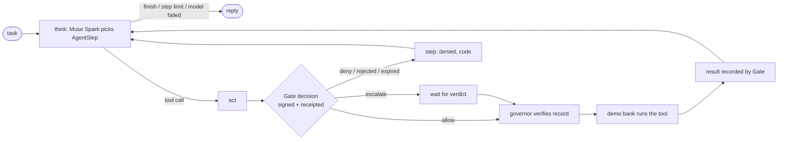

# Agent (`agent/`): the payments-ops agent on LangGraph and Muse Spark

Guarantees that the demo agent's every tool call goes through Gate, and that the bank sees a call only after the agent has verified Gate's signed, receipted decision itself, plus an approval when the decision was escalate. The model picks the steps. It cannot reach the bank, the ledger or Gate's internals, and nothing it says can make a tool run.

Status: done for this step (demo beat 2 with the real agent, `make demo-agent`). Run on the `mock` profile only; Muse Spark (`muse-spark-1.3`) has not driven it yet (a `live` test is ready). · Last updated: 2026-10-29 · Tests: 22 unit (`test_agent.py` 18, `test_agent_cli.py` 4) plus 1 `live`, 9 delegation tests in `test_delegation_flow.py`, 3 mock-script tests in `test_assist_mock.py`, 2 `run_cleared` tests in `test_gate_governed.py`, 4 import-boundary checks. Coverage: `steps.py` 100%, `graph.py` 98%, `bank.py` 97%, `cli.py` 89%.

Related pages: [`gate.md`](gate.md) (`@governed`, decisions, escalations), [`assist.md`](assist.md) (the model entry point and the mock), [`../MODELS.md`](../MODELS.md), [`../DECISIONS.md`](../DECISIONS.md) D78–D79.

## Responsibilities

Owns:

| Part | File |
| --- | --- |
| One step: the `AgentStep` schema, `check_step`, what the model sees (`render_task`), `StepPlanner`, `StepRecord` | `agent/steps.py`, `assist/prompts/agent_step.md` |
| The LangGraph loop (`think`, `act`), step limit, repeat guard, progress `Observer` | `agent/graph.py` |
| The demo bank behind the three tools: vendor directory, payments, outbox | `agent/bank.py`, `deploy/demo/vendors.json` |
| Wiring from `KEYS_DIR` and the model profile; `pl-agent`; progress printing | `agent/cli.py` |
| Beat 2 with the agent, auto-approving as j.ortiz | `scripts/demo_agent.py` (`make demo-agent`) |
| The mock's script for `AgentStep` | `assist/mock.py` (`_agent_step`) |

Does not own:

- **Deciding.** Gate decides allow, deny or escalate with Cedar (R2). The agent only learns the outcome.
- **Verifying records.** `gate.governed.Governor` checks Gate's signature, the log receipt, the agent, tool and argument digest, and the approval before the tool runs (D51). The agent calls `Governor.run_cleared`.
- **Model calls.** Steps go through `assist/llm.py` (role `spark`). No LangChain chat model is imported (an import test enforces it).
- **Approving.** Approvers use Gate's API; the agent has an agent token only.

## How it works

**Delegation (D89).** `open_agent` loads the principal's signed credential from `KEYS_DIR/credentials/<agent>.json` (`AGENT_CREDENTIAL_FILE` to override; written by `make delegate`) and gives it to `Governor`, which sends it with every call. With no file the agent presents nothing, and a Gate that requires delegation denies every call (`delegation.missing`); a malformed file stops startup (`config.credential`). The agent cannot widen the credential: the principal signed it, and Gate verifies it.


### Beat 2 end to end

Task: "Pay Northwind Supply $48,000.00 for invoice INV-4471."

1. `think`: the model gets the task and an empty step list and returns `lookup_vendor {"query": "Northwind Supply"}`.
2. `act`: the governor asks Gate. `data.read` of vendor data is allowed (rule `vendor-lookup-01`), so the decision record is verified and the bank runs the lookup. Gate records the result digest.
3. `think`: the model sees one vendor, `northwind-supply`, and returns `create_payment {"payee_id": "northwind-supply", "amount": "48000.00", "currency": "USD", "memo": "Invoice INV-4471"}`.
4. `act`: Gate escalates (new payee, over $5,000: `pay-new-payee-01`, `pay-over-5k-01`). The observer prints "held by Gate" with the decision record id. Gate writes the brief and j.ortiz approves. The governor verifies the verdict record, then the bank pays.
5. `think` → `send_email` to `accounts-payable@harborfederal.example` with the payment id. It's an internal recipient, so `email-internal-01` allows it.
6. `think` → `finish` with a reply naming the amount, vendor, payment id and invoice.

The ledger then holds, in order: decision, result (lookup); decision, verdict, result (payment); decision, result (email). The beat 2 test asserts exactly this.



### What the model sees

One system message (`agent_step/1`) and one user message:

```
Task:
Pay Northwind Supply $48,000.00 for invoice INV-4471.

Steps so far:
[{"n": 1, "tool": "lookup_vendor", "arguments": {"query": "Northwind Supply"}, "outcome": "ok",
  "result": {"vendors": [{"id": "northwind-supply", ..., "account": "****0381"}]},
  "gate": {"decision": "allow", "decision_record_id": "01M62H..."}}]
```

Every call sends the whole history, so the model keeps no state of its own. Each step shows Gate's answer: `ok`, `denied` with Gate's code (`policy.forbid`, `gate.rejected`, `gate.expired`, `gate.unreachable`, …), `error` with the tool's code, or `skipped`. The model's own `note` is not sent back. `assist/llm.py` masks long digit runs before sending.

### The step schema (D78)

`AgentStep` = `note`, `tool` (`lookup_vendor`, `create_payment`, `send_email` or `finish`), one nullable argument object per tool, and `reply`. Meta's strict structured output enforces the shape. `check_step` then requires the chosen tool's arguments, and only those, and a reply when finishing. A failure gets one retry with the problems fed back. Argument values are only length-limited here; Gate's normalizer is what validates them (`gate.bad_arguments` is a deny).

## Interfaces

| Function / command | Input | Output | Errors |
| --- | --- | --- | --- |
| `PaymentsAgent(planner, governor, bank, max_steps=8).run(task, observer=None)` | task, 1–2,000 characters | `AgentRun(task, steps, reply, stopped)` | `ValueError` for an empty or long task. Denials, tool failures and model failures are steps or `stopped`, never exceptions |
| `StepPlanner(llm).next_step(task, steps)` | the task and the `StepRecord`s so far | `AgentStep` | `ModelOutputError` after two bad answers |
| `check_step(step)` | `AgentStep` | list of problems | — |
| `render_task(task, steps)` | | the user message | — |
| `Observer.started(n, step)` / `.held(n, decision_record_id)` / `.finished(record)` | | progress for the CLI, later the web page | — |
| `DemoBank.call(tool, arguments)` | | the tool's result | `ToolFailed` (`bank.unknown_payee`, `bank.unknown_tool`) |
| `open_agent(settings, agent_settings)` | | the agent wired to `pl-gate` over HTTP | `ConfigError` `config.keys`, `config.model_profile` |
| `uv run pl-agent "<task>"` | | prints each step and the reply; exit 1 if the run stopped early | |
| `make demo-agent` (`ARGS="--manual"`, `ARGS='--task "..."'`) | | beat 2, approving as j.ortiz after showing the brief | |
| `Governor.run_cleared(tool, args, effect, on_hold=None)` (in `gate/governed.py`) | | `Cleared(result, decision, verdict)` | `GateDenied`, or the effect's exception |

`StepRecord` fields: `n`, `note`, `tool`, `arguments`, `outcome` (`ok`, `denied`, `error`, `skipped`), `result`, `code`, `decision` (`allow`, `escalate`, `deny`), `decision_record_id`, `verdict_record_id`.

## Data

The agent writes no records itself. Gate writes `gate.decision`, `gate.verdict` and `gate.result` for each call, and `assist.brief` for a held one (see [`gate.md`](gate.md)).

| File or setting | Meaning |
| --- | --- |
| `deploy/demo/vendors.json` | The demo vendor directory: `id`, `name`, `email`, `onboarded`, `account_last4`. Five match Gate's known payees; `northwind-supply` (onboarded 2026-10-26) is new |
| `KEYS_DIR/tokens/<AGENT_ID>.token` | The agent's bearer token for Gate |
| `KEYS_DIR/trusted.json` | Producer and log public keys the governor verifies against |
| `AGENT_ID` | `payments-ops` |
| `AGENT_GATE_URL` | `http://127.0.0.1:8070` |
| `AGENT_GATE_PRODUCER_ID` | `gate-1`: the only producer whose decisions the agent accepts |
| `AGENT_VENDORS_FILE` | `deploy/demo/vendors.json` |
| `AGENT_MAX_STEPS` | 8 |
| `AGENT_GATE_TIMEOUT_SECONDS` | 30, longer than one escalation long poll (25 s) |
| `MODEL_PROFILE` | `mock`, `cloud` (Muse Spark) or `onprem` |

The bank keeps `lookups`, `payments` and `outbox` in memory for the run. Lookups return the account's last four digits only, because tool results go back to the model.

## Security and failure behaviour

| Situation | What happens | Test |
| --- | --- | --- |
| No delegation credential, or a revoked one (with `GATE_REQUIRE_DELEGATION=true`) | The first call is `denied delegation.missing` / `delegation.revoked`; nothing runs, not even the vendor lookup (D88, D89) | `test_without_a_credential_nothing_runs`, `test_a_revoked_credential_stops_the_agent` |
| A payment beyond the credential (amount, payee) | `denied delegation.out_of_scope` before the policy is asked | `test_a_payment_beyond_the_credential_is_denied_even_where_policy_would_hold` |
| Gate unreachable | The first call is `denied gate.unreachable`; the bank never runs; the agent finishes saying so | `test_with_gate_unreachable_no_tool_runs`, `test_with_no_gate_listening_the_cli_reports_and_nothing_runs` |
| Payment over the cap | `denied policy.forbid` at once, no escalation, no payment | `test_a_payment_over_the_cap_is_denied_without_asking_anyone` |
| Supervisor rejects | `denied gate.rejected`; no payment, no email | `test_a_rejected_payment_is_never_made_and_the_agent_says_so` |
| Model repeats a call | `skipped agent.duplicate_call`; it never reaches Gate, so there is no second payment and no second ask (D79) | `test_the_same_call_is_never_sent_twice` |
| Model loops | The run stops at 8 steps (`agent.step_limit`) | `test_the_run_stops_at_the_step_limit` |
| Model output bad twice, or model down | The run stops with the `model.*` code; nothing runs | `test_a_failed_model_call_ends_the_run_with_nothing_done` |
| The tool fails after clearance | Gate records an `error` result; the step is `error` with the tool's code | `test_a_tool_failure_is_recorded_and_reported` |
| Forged or mismatched Gate record | The governor raises `GateDenied` (`gate.bad_record`, `gate.mismatch`); the step is `denied` | `test_gate_governed.py` |
| The agent edits its own trail | It has no path: no ledger store, ledger service or Gate internals imported, no signing key | `test_the_agent_has_no_ledger_write_path_and_no_model_client` |
| Agent state sent to LangSmith | Tracing is forced off before LangGraph loads (D78) | — (environment set in `agent/graph.py`) |

Not protected against: a model that pays the wrong vendor or amount within policy. Gate allows what the policy allows. A $120 payment to a known payee goes through without a human, and the record of it is all that stops it going unnoticed. Prompt injection through tool results (for example a vendor name with instructions in it) can steer the model's next step, but every step still goes through Gate.

## How to run and test

```sh
make check                     # includes tests/unit/test_agent.py and test_agent_cli.py
make serve; make gate          # in two terminals (see docs/runbook.md)
make demo-agent                # beat 2: lookup, $48,000 held, brief, j.ortiz approves, paid, AP told
uv run python scripts/demo_agent.py --task 'Pay Acme Paper $300,000 for invoice INV-9.'
uv run pl-agent 'Pay Keystone IT $120 for invoice INV-2.'
make delegate                  # with GATE_REQUIRE_DELEGATION=true: the principal delegates to the agent
make delegate ARGS=revoke      # ...and takes it back; the agent's next call is denied
uv run pytest -m live -s -k muse_spark tests/unit/test_agent.py   # the real model (META_API_KEY)
```

Sample (`make demo-agent`, mock profile, Oct 28):

```
task: Pay Northwind Supply $48,000.00 for invoice INV-4471.
1. lookup_vendor {'query': 'Northwind Supply'}
   ok (Gate allow): {'vendors': [{'id': 'northwind-supply', ..., 'account': '****0381'}]}
2. create_payment {'payee_id': 'northwind-supply', 'amount': '48000.00', 'currency': 'USD', 'memo': 'Invoice INV-4471'}
   held by Gate: decision 01M62HGHE7R1TXT0JAJQB24B03; waiting for an approver
  brief (mock/scripted, approval_brief/2): payments-ops wants to pay $48,000.00 to northwind-supply; ...
  j.ortiz approved: verdict record 01M62HGHM7FMPEMY1X13C04JYE
   ok (Gate escalate, approved in 01M62HGHM7FMPEMY1X13C04JYE): {'payment_id': 'pay-01m62hghn8x1v7q6f7ybgqn54m', 'status': 'sent', ...}
3. send_email {'to': ['accounts-payable@harborfederal.example'], ...}
   ok (Gate allow): {'message_id': 'msg-01m62hghpb1j9077bd3d148mrp', 'status': 'queued'}
reply: Paid $48,000.00 to Northwind Supply (payment pay-01m62hghn8x1v7q6f7ybgqn54m, Invoice INV-4471) and told accounts payable.
```

## Decisions

- D51: the agent-side wrapper verifies Gate's records itself.
- D72: the `mock` profile.
- D78: structured steps through `assist/llm.py`, LangGraph without LangChain models, tracing off.
- D88, D89: the agent presents its principal's delegation credential with every call.
- D79: step limit, repeat guard, `run_cleared`, the demo bank, the internal confirmation email.

## Known gaps

- Muse Spark has driven the agent live (`agent_step/1` timings in `docs/MODELS.md`), but the unit tests run it against the mock script only; the `live` test is skipped by default.
- One run at a time from the CLI. The web page will start runs and stream `Observer` events.
- The bank is in memory and forgets between runs; the ledger is the lasting record.
- No MCP proxy: tools are called through `@governed` only (cut order, skill §11).
