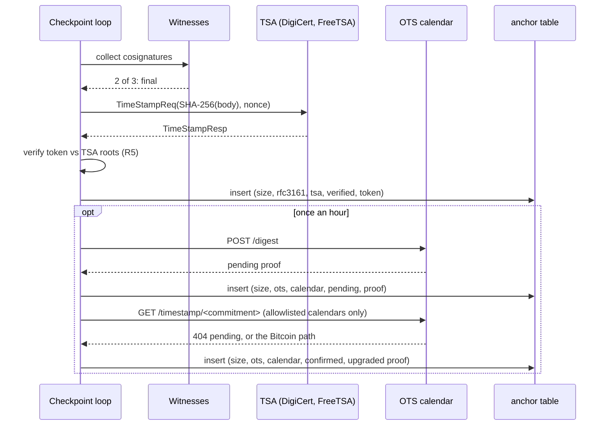

# Anchors (`anchor/`): RFC 3161 timestamps and OpenTimestamps

Guarantees that every final checkpoint gets a time from outside parties that the operator and the witnesses cannot backdate. Every RFC 3161 token is checked offline, and a ledger rebuilt later is caught even if every witness helped, because its records claim times no timestamp authority signed. OpenTimestamps proofs tie each checkpoint to a Bitcoin block.

Status: done for this step. Covers RFC 3161 request, verify, store, serve and export, and OpenTimestamps submit, upgrade, store and export. `pl-verify --tsa-roots` checks tokens and backdating. Still missing: a confirmed Bitcoin proof in the vectors, which needs hours of confirmation (O5, `make ots-upgrade`), and revocation checks. · Last updated: 2026-10-28 · Tests: 88 unit + property (`anchor/rfc3161.py` 95%, `anchor/ots.py` 98%, `anchor/clients.py` 100%, `ledger/anchoring.py` 99%, `verify/anchors.py` 100%), 1 integration over Postgres, real tokens from two public TSAs and real calendar responses as test vectors, plus a live run (below)

Related pages: [`witness.md`](witness.md) (anchoring starts once a checkpoint is final), [`verify.md`](verify.md) (offline checks), [`api.md`](api.md) (where anchors are served).

## Responsibilities

Owns:

| Part | File | Runs in |
| --- | --- | --- |
| RFC 3161 requests and full offline token verification | `anchor/rfc3161.py`, pure | Ledger, verifier |
| Reading and upgrading OpenTimestamps proofs | `anchor/ots.py`, pure | Ledger, verifier |
| HTTP clients for a TSA and a calendar | `anchor/clients.py` | Ledger |
| When to timestamp, submit and upgrade; the `AnchorStore` port; serving verified summaries | `ledger/anchoring.py` | Ledger |
| `anchor` table | `ledger/schema.sql`, `ledger/pg_tree.py` | Ledger database |
| `anchors/` in bundle v2 | `ledger/export.py`, `verify/bundle.py` | Ledger, verifier |
| Timestamp and backdating checks | `verify/anchors.py` | Auditor's machine |
| TSA roots for the demo, with fingerprints | `deploy/tsa/roots.pem`, `deploy/tsa/README.md` | Ledger |

Does not own:

- What is final. Only checkpoints that reached the witness quorum are anchored (see [`witness.md`](witness.md)).
- Checking a Bitcoin block header. The verifier is offline, so it reports the block height and merkle root a proof claims, and someone checks those against a Bitcoin node.

The verifier imports only `anchor.rfc3161` and `anchor.ots`, which import no network or file code. The import test enforces this.

## How it works

1. A checkpoint becomes final (2 of 3 witnesses).
2. **RFC 3161.** The ledger sends `SHA-256(checkpoint body)` to each configured TSA with a random nonce. It keeps the token only if the response answers that request and the whole token verifies against the configured TSA roots. One token per TSA per size.
3. **OpenTimestamps.** At most once per `OTS_INTERVAL_SECONDS` (an hour), the latest final checkpoint's digest goes to each calendar. The answer must be a proof from that digest ending in a pending attestation. In the same tick, every pending proof is offered to its calendar for an upgrade, but only if that calendar is in `OTS_UPGRADE_CALENDARS`. A proof that now reaches a Bitcoin attestation is stored as a new `confirmed` row.
4. The API serves anchors only after verifying them again. The export carries them all.
5. **Offline**, `pl-verify --tsa-roots` checks every token against the auditor's roots. It then compares each record's own `ts` with the earliest trusted time of a checkpoint that covers it.



## Interfaces

### Pure functions

| Function | Input | Output | Errors (`AnchorError`) |
| --- | --- | --- | --- |
| `anchor_digest(checkpoint)` | `Checkpoint` | `SHA-256(body)` | |
| `timestamp_request(digest, nonce)` | | DER TimeStampReq (SHA-256, `certReq`) | `anchor.bad_timestamp` |
| `token_from_response(response, digest, nonce)` | DER TimeStampResp | DER token | `anchor.tsa_refused`, `anchor.wrong_digest`, `anchor.bad_timestamp` |
| `verify_token(token, digest, roots)` | DER token, trusted root certificates | `TimestampInfo(gen_time, tsa, serial, policy)` | `anchor.bad_timestamp`, `anchor.bad_signature`, `anchor.wrong_digest`, `anchor.untrusted` |
| `load_roots(pem)` | PEM bundle | certificates | `anchor.bad_roots` |
| `read_timestamp(proof, digest)` | OpenTimestamps timestamp | `[Attestation(kind, commitment, calendar, height)]` | `anchor.bad_ots` |
| `upgrade_timestamp(proof, digest, commitment, upgrade)` | | proof with that pending branch replaced | `anchor.bad_ots` |

### Ledger side

| Function / endpoint | Behaviour |
| --- | --- |
| `Anchorer.anchor(signed)` | RFC 3161 from each TSA missing for this size; OTS submit and upgrade when due. Returns `AnchorResult(size, timestamped_by, failures)` |
| `AnchoredPublisher.publish()` | Publish (and witness), then anchor. Raises `anchor.no_timestamp` if TSAs are configured and none timestamped it; the checkpoint is still stored |
| `GET /ledger/v1/checkpoints/latest` | `anchors: [{kind, source, status, gen_time, tsa}]` for RFC 3161 and `[{kind, source, status, attestations}]` for OTS, all re-verified. `503 anchor.unverifiable` if a stored anchor no longer verifies |
| `GET /ledger/v1/export` | Bundle v2 with `anchors/` |
| `GET /ledger/v1/health` | `checkpoint_errors` shows `anchor.no_timestamp` while no TSA answers |

### Commands

| Command | What it does |
| --- | --- |
| `pl-verify … --tsa-roots ROOTS.pem [--max-timestamp-lag S]` | Checks tokens and backdating (default lag 3600 s) |
| `make ots-upgrade` | Upgrades `tests/vectors/ots-published.json` once Bitcoin confirms it, and prints the block and merkle root (O5) |

## Data

**`anchor` table** (insert-only; triggers reject `UPDATE`, `DELETE` and `TRUNCATE`; the app role has `INSERT` and `SELECT` only):

| Column | Meaning |
| --- | --- |
| `stream`, `tree_size` | The checkpoint; foreign key to `checkpoint` |
| `kind` | `rfc3161` or `ots` |
| `source` | TSA name, or calendar URL |
| `status` | `verified` (RFC 3161), `pending` or `confirmed` (OTS). An upgrade adds a `confirmed` row; the `pending` row stays |
| `token` | DER token, or the serialized OpenTimestamps timestamp |
| `digest` | `SHA-256(checkpoint body)`, kept so pending proofs can be upgraded |

Primary key `(stream, tree_size, kind, source, status)`; the first row wins.

**Bundle v2** adds `anchors/<20-digit size>-<rfc3161|ots>-<nn>.<tsr|ots>`, each at most 64 KiB, and `counts.anchors` in the manifest. The size in the name is only a label: a token moved to another checkpoint fails its digest check. The reader still accepts v1 bundles and refuses anchors inside a v1 bundle.

**Configuration**:

| Variable | Default (`.env.example`) | Meaning |
| --- | --- | --- |
| `TSAS` | empty (`digicert=…,freetsa=…`) | RFC 3161 TSAs, `name=url` |
| `TSA_ROOTS_FILE` | `deploy/tsa/roots.pem` | Roots the ledger checks tokens against before storing |
| `OTS_CALENDARS` | empty (`a.pool`, `b.pool`) | Calendars to submit to (https only) |
| `OTS_UPGRADE_CALENDARS` | `alice`, `bob` `.btc.calendar.opentimestamps.org` | The only hosts asked for upgrades |
| `OTS_INTERVAL_SECONDS` | `3600` | OTS cadence |
| `ANCHOR_TIMEOUT_SECONDS` | `10` | Per request |

## Security and failure behaviour

| Threat or failure | Behaviour | Test |
| --- | --- | --- |
| Operator and every witness rebuild history later and re-cosign it (ARCHITECTURE threat row) | Records still claim their original `ts`, but no TSA signs a past time, so `late_timestamp` names the first record. Witnesses alone cannot catch this | `test_backdated_history_is_caught` |
| Record claims a time after its checkpoint was already timestamped | `record_after_timestamp` (beyond 300 s skew) | `test_record_claiming_a_time_after_its_timestamp` |
| Token for another digest, or relabelled to another checkpoint | `anchor.wrong_digest` / `bad_timestamp` | `test_token_relabelled_to_another_checkpoint_fails`, `test_published_tokens_verify_offline` |
| Forged or altered token: signature, message digest attribute, content type, ESS certificate binding, extra signer, missing certificates | Each rejected with its own reason | `test_broken_tokens_are_rejected` (8 cases), `test_more_broken_tokens` (3), `test_ess_naming_another_certificate_is_rejected` |
| Signer is not a timestamping certificate (no EKU, wrong EKU, non-critical EKU) | Rejected | `test_signer_must_be_a_critical_timestamping_certificate` |
| TSA not trusted by the auditor, chain too long, a certificate or root not valid at `genTime` | `anchor.untrusted` / `bad_timestamp`. One TSA's root never vouches for another's token | `test_untrusted_root_is_rejected`, `test_chain_too_long_is_rejected`, `test_root_expired_at_gentime_is_rejected` |
| TSA response not for our request (nonce, digest, status) | Not stored | `test_response_checks`, `test_http_tsa_verifies_what_it_gets` |
| TSA down | Other TSAs suffice. With none, `anchor.no_timestamp` shows in health and the checkpoint is still stored | `test_one_of_two_tsas_is_enough`, `test_tsa_outage_shows_in_health` |
| Edited anchor row | API `503 anchor.unverifiable`; `pl-verify` `bad_timestamp`; triggers block edits | `test_an_edited_anchor_row_is_never_served`, integration test |
| Hostile OTS proof (unknown op, truncated, trailing bytes, huge lengths, too deep, too long, non-https calendar URL) | `anchor.bad_ots`, never a partial read | `test_hostile_proofs_are_rejected` (13 cases) |
| Calendar points upgrades elsewhere (SSRF) | Only `OTS_UPGRADE_CALENDARS` are contacted | `test_upgrades_go_only_to_configured_calendars` |
| Calendar returns garbage as an upgrade | Recorded as a failure, never as confirmed | `test_bad_upgrade_is_a_failure_not_a_confirmation` |
| Checkpoint without a witness quorum | Not anchored | `test_checkpoints_without_quorum_are_not_anchored` |

What anchors do not protect against yet:

- **Revoked TSA certificates.** OCSP and CRLs need the network. Tokens are checked against roots and validity at `genTime` only.
- **A Bitcoin block that does not contain the proof.** Checking it needs a Bitcoin node. `pl-verify` prints the height and merkle root to check.
- **A TSA that lies about time, or colludes with the operator.** Two independent TSAs (DigiCert, FreeTSA) are configured; the verifier reports each token, and the earliest trusted time counts.
- **Backdating within the lag window.** A record can claim up to `--max-timestamp-lag` (1 hour) before it was first timestamped. Tighten the lag for stricter audits; checkpoints run every 10 s.

## Formulas and formats

| Item | Definition |
| --- | --- |
| Anchored digest | `SHA-256(checkpoint body)`, the body being the C2SP text `origin\nsize\nbase64 root\n` |
| RFC 3161 request | `TimeStampReq{v1, messageImprint{sha256, digest}, nonce (63 random bits), certReq true}` |
| Signed attributes check | Signature over `0x31 ‖ DER(signedAttrs)[1:]`, the SET form (RFC 5652 §5.4) |
| ESS binding | `signingCertificateV2.certHash = SHA-256(signer cert DER)` (or v1, SHA-1) |
| OTS operations | `0xf0` append, `0xf1` prepend, `0x08` SHA-256; `0xff` fork; `0x00 tag payload` attestation. Pending tag `83dfe30d2ef90c8e`, Bitcoin tag `0588960d73d71901` |
| Backdating rule | For record `s`: `T(s) = min genTime over trusted tokens of checkpoints with size ≥ s`. Finding if `T(s) − ts(s) > max lag`, or `ts(s) − T(s) > 300 s` |

Worked example, from `tests/vectors/rfc3161-published.json`, captured 2026-10-28 from the real TSAs:

```text
checkpoint body   precept-ledger.local/harbor-federal/decisions\n3\nXId9QnIn93Thb1lnOkqdn7CEMh2Ue7bbju3LcNFwOgs=\n
digest            SHA-256(body), stored as digest_hex in the vector
freetsa token     ECDSA (P-384) with SHA-512, chain to Free TSA Root CA, genTime 2026-10-28T13:37:22Z
digicert token    RSA-4096 PKCS#1 v1.5 with SHA-256, chain via a cross-signed DigiCert Trusted Root G4, genTime 2026-10-28T13:37:22Z
```

`test_published_tokens_verify_offline` checks both tokens against their own roots, rejects them for any other digest, and rejects each under the other TSA's root. `tests/vectors/ots-published.json` holds the two calendars' real pending proofs for the same digest. `test_published_calendar_responses_commit_to_the_checkpoint` reads them down to the pending attestations at `alice.btc` and `bob.btc.calendar.opentimestamps.org`.

## How to run and test

```sh
# .env: TSAS, TSA_ROOTS_FILE, OTS_CALENDARS as in .env.example
make witnesses &                 # anchoring follows finality
make serve
curl -s localhost:8080/ledger/v1/checkpoints/latest?final=true      # anchors: [...]
curl -s -o export.tar localhost:8080/ledger/v1/export
uv run pl-verify export.tar --keys "$KEYS_DIR/trusted.json" \
  --witness-keys "$KEYS_DIR/witnesses.txt" --tsa-roots deploy/tsa/roots.pem
make ots-upgrade                 # hours later: record the confirmed Bitcoin proof (O5)
uv run pytest tests/unit/test_rfc3161.py tests/unit/test_ots.py tests/unit/test_anchoring.py \
  tests/unit/test_verify_anchors.py tests/unit/test_api_anchored.py
```

Live run on 2026-10-28. Three witnesses, `pl-ledger` over Postgres, DigiCert and FreeTSA, both OTS pools, 3-second checkpoints, a 20-second OTS interval, three appended records. `pl-verify` output on `GET /ledger/v1/export`:

```text
records           3  chain and producer signatures verified through seq 3
receipts          3
checkpoints       2  latest: size 3, root JFdF2uuNdEDrDOxqGyDhCTT+/XAquxwluGfpnwRNrqg=
unanchored        0  records after the latest checkpoint
witnessed         0  records after the latest final checkpoint; final: size 3, 3 of quorum 2 (witness-1, witness-2, witness-3)
timestamped       0  records after the latest timestamped checkpoint; latest: size 3 at 2026-10-28T13:50:29+00:00 by www.freetsa.org
bitcoin           size 3: pending at https://alice.btc.calendar.opentimestamps.org
bitcoin           size 3: pending at https://bob.btc.calendar.opentimestamps.org
RESULT  OK
```

The run also anchored the empty tree (size 0). The "by" field now shows the TSA's common name; during the run it printed the full subject, and that change came straight after.

## Decisions

D44, D45, D46, D47, D48 in [`docs/DECISIONS.md`](../DECISIONS.md); O3 (TSA choice) is resolved by D45.

## Known gaps

- No confirmed Bitcoin proof in the vectors yet. Run `make ots-upgrade` after confirmation (O5); the test for it activates on its own.
- No revocation checks (OCSP or CRL) for TSA certificates.
- Bitcoin attestations are reported, not verified, offline.
- RFC 3161 requests run inside the checkpoint tick, so a slow TSA delays the next checkpoint by up to `ANCHOR_TIMEOUT_SECONDS` per TSA.
- No way yet to hand `pl-verify` a token the auditor kept separately; `--trusted-checkpoint` covers held checkpoints.
- The `make demo-rogue` script shows the witness beat only. The collusion and backdating case is covered by `test_backdated_history_is_caught`, because a real TSA cannot be made to sign a past time.
