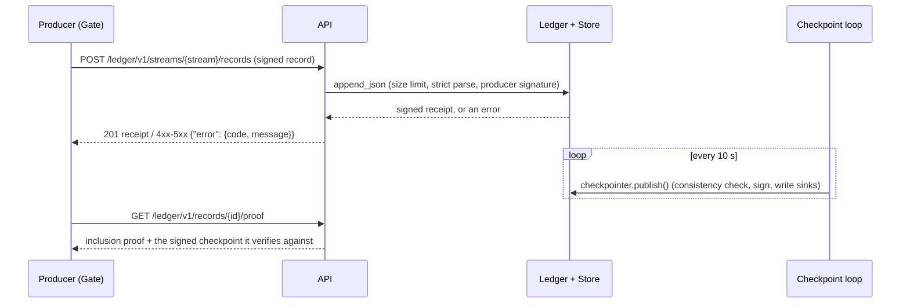

# Ledger API (`pl-ledger`)

Guarantees that producers can append signed records over HTTP and get a signed receipt or a clear error, never anything in between. Checkpoints are signed every 10 seconds, and anyone can fetch records, inclusion and consistency proofs, the latest checkpoint and an export bundle.

Status: done for this step (6 ledger endpoints plus health, checkpoint loop, JSON logs with `trace_id`, `pl-ledger`, dev keys). Batch append, range export, authentication for reads and anchors in `checkpoints/latest` are not built. Witness cosignatures and finality are served; see [`witness.md`](witness.md). · Last updated: 2026-10-27 · Tests: 42 unit (`api.py`, `checkpoint_loop.py`, `common/logging.py` 100%), 2 integration over Postgres, plus a live smoke run (below)

Part of `ledger/`. Records and receipts: [`ledger.md`](ledger.md). Checkpoints: [`checkpoints.md`](checkpoints.md). Bundle and verifier: [`verify.md`](verify.md).

## Responsibilities

Owns:

- HTTP routes, status codes and error bodies (`ledger/api.py`).
- The background checkpoint loop (`ledger/checkpoint_loop.py`).
- JSON logging with a per-request `trace_id` (`common/logging.py`).
- Wiring for real deployments: keys from `KEYS_DIR`, Postgres, sinks (`ledger/server.py`, the `pl-ledger` command).
- Local development keys (`scripts/dev_keys.py`, `make dev-keys`).

Does not own:

- Any ledger logic. Every route calls `Ledger`, `LogTree`, the checkpoint sinks or `export_bundle`.
- Witness and Gate endpoints (`/witness/v1/…`, `/gate/v1/…`), which belong to their own modules. Shared HTTP plumbing (error bodies, size-limited reads, request logs) lives in `common/http.py` (D43).

## How it works

`create_app(open_services, checkpoint_interval=…)` builds a FastAPI app. On startup it enters `open_services()`, an async context manager that yields `Services(ledger, store, logs)`, where `logs` maps each served stream to its `StreamLog` (tree, sink, checkpointer, log key). Tests pass memory services; `pl-ledger` passes Postgres ones. If an interval is set, a `CheckpointLoop` task publishes every stream's checkpoint on each tick.



## Interfaces

| Method and path | Input | Output | Errors |
| --- | --- | --- | --- |
| `POST /ledger/v1/streams/{stream}/records` | One signed record (submission) as JSON, at most 64 KiB, `content-type: application/json` | `201` receipt | `400 format.*`, `ledger.stream_mismatch`; `403 signature.*`; `404 ledger.unknown_stream`; `409 ledger.duplicate_record`; `413 format.too_large`; `415 request.media_type`; `503 store.unavailable` |
| `GET /ledger/v1/records/{id}` | | `{record, receipt}` | `404 ledger.not_found` |
| `GET /ledger/v1/records/{id}/proof?size=N` | `N` must be a checkpoint size; default is the latest checkpoint | `{record_id, seq, leaf_index, tree_size, leaf_hash, hashes, checkpoint, final}`. `checkpoint` is the signed note with its verified cosignatures, so the proof can be checked without trusting the API | `404 checkpoint.not_found`; `409 proof.not_checkpointed`; `422 request.invalid`; `503 checkpoint.inconsistent`, `checkpoint.unverifiable`, `cosignature.unverifiable` |
| `GET /ledger/v1/checkpoints/latest?stream=&final=` | `final=true`: the latest checkpoint with a witness quorum | `{stream, size, root, note, cosignatures: [{witness, timestamp}], quorum, final, anchors: []}`. `note` carries the verified cosignature lines | `404 checkpoint.not_found`; `503 checkpoint.unverifiable`, `cosignature.unverifiable` |
| `GET /ledger/v1/consistency?from=M&to=N&stream=` | `0 ≤ M ≤ N ≤ tree size` | `{stream, from, to, hashes}` | `400 merkle.bad_size`; `422 request.invalid` |
| `GET /ledger/v1/export?stream=` | `from`/`to` refused for now | `application/x-tar` bundle v1 | `400 export.range_unsupported` |
| `GET /ledger/v1/health` | | `{status, checkpoint_loop: disabled\|running\|stopped, streams, witnesses: {stream: {count, quorum} \| null}, checkpoint_errors}`; `witness.no_quorum` appears here while a checkpoint lacks a quorum | `503` when the loop has stopped |

`stream` may be left out when the server serves exactly one stream; otherwise it is required (`400 request.stream_required`). Every response carries `x-trace-id`. A caller's 32-hex `x-trace-id` is kept, and anything else is replaced with a new id.

Commands: `pl-ledger` (serve), `make serve` (apply the schema, then serve), `make dev-keys`.

## Data

Reads and writes only what the ledger and checkpoint modules already own. Configuration (all in `.env.example`):

| Variable | Default | Meaning |
| --- | --- | --- |
| `DATABASE_URL` | required | App role: INSERT and SELECT only |
| `KEYS_DIR` | required | `log.pem` and `trusted.json` (the same format as `pl-verify --keys`), outside the repo |
| `LEDGER_STREAM` | `harbor-federal/decisions` | The one stream `pl-ledger` serves |
| `LEDGER_ORIGIN` | `precept-ledger.local` | Checkpoint origin prefix |
| `CHECKPOINT_DIR` | `var/checkpoints` | Write-once directory; files go under `<dir>/<stream>/` |
| `CHECKPOINT_INTERVAL_SECONDS` | `10` | Loop interval |
| `API_HOST`, `API_PORT` | `127.0.0.1`, `8080` | Bind address; localhost because reads are unauthenticated |
| `WITNESSES`, `WITNESS_QUORUM`, `WITNESS_TIMEOUT_SECONDS` | empty, `2`, `5` | Witnesses to ask after each checkpoint (`name=url,…`); keys from `KEYS_DIR/witnesses.txt`. See [`witness.md`](witness.md) |
| `LOG_LEVEL` | `INFO` | |

A log line looks like this, taken from the live run below:

```json
{"ts": "2026-10-27T18:55:07.801Z", "level": "INFO", "logger": "pl.ledger.api", "msg": "request", "trace_id": "727df24e88bbce733a4152087b3f9e1e", "method": "POST", "route": "/ledger/v1/streams/{stream:path}/records", "status": 201, "duration_ms": 5.2}
```

Only the route template is logged: no raw path, query or body. uvicorn's own access log is turned off because it would log the raw path.

## Security and failure behaviour

| Threat or failure | Behaviour | Test |
| --- | --- | --- |
| Database down | `503 store.unavailable`, never a receipt; the loop records `store.unavailable` and health shows it | `test_store_down_is_503_and_never_a_receipt`, `test_database_down_means_no_receipt` (Postgres) |
| Unsigned, misattributed or rogue-signed record | `403`, nothing stored | `test_unknown_producer_key_is_403` |
| Malformed JSON (duplicate keys, floats, wrong fields) | `400 format.*` | `test_malformed_submissions_are_400` (5 cases) |
| Oversized body, with or without `Content-Length` | `413`, read stops at 64 KiB | `test_oversized_body_is_413`, `test_body_over_the_limit_without_content_length_is_413` |
| Tree no longer matches its signed checkpoint | Proof refused, `503 checkpoint.inconsistent` | `test_proof_fails_closed_if_the_tree_no_longer_matches` |
| Stored checkpoint signed by another key | Never served: `503 checkpoint.unverifiable` | `test_stored_checkpoint_under_another_key_is_never_served` |
| Unexpected exception | `500 {"code": "internal"}`; the message is never echoed, and only the exception type is logged | `test_store_down_is_503_and_never_a_receipt` |
| Invalid query parameters | `422 request.invalid`; FastAPI's default body, which echoes the input, is replaced | `test_proof_errors` |
| Checkpoint loop: one stream fails | That stream is logged and skipped; the others are still checkpointed | `test_run_once_publishes_each_stream_and_isolates_failures` |
| Checkpoint loop: a bug | The loop stops, health returns `503` with `stopped` | `test_unexpected_error_stops_the_loop_visibly`, `test_health_reports_a_running_then_stopped_loop` |
| `log.pem` and `trusted.json` disagree, or are missing | `pl-ledger` refuses to start (`ConfigError config.keys`) | `test_log_key_not_in_trusted_file_fails`, `test_missing_keys_fail` |
| Dev keys written into the repo | The script refuses; private keys are mode 0600; only key ids are printed | `test_server_keys.py` |

Not protected yet: reads have no authentication (records can contain business data), so the server binds to localhost. There is no rate limiting. uvicorn still logs tracebacks of unexpected errors to stderr.

## Formulas and formats

None new. The API serves bytes defined in [`ledger.md`](ledger.md), [`checkpoints.md`](checkpoints.md) and [`verify.md`](verify.md), with hashes in standard base64 (D19).

## How to run and test

```sh
make dev-keys                 # KEYS_DIR from .env; creates gate-1.pem, log.pem, trusted.json
make serve                    # schema, then pl-ledger on 127.0.0.1:8080
curl -s localhost:8080/ledger/v1/health
curl -s -o export.tar localhost:8080/ledger/v1/export && uv run pl-verify export.tar --keys "$KEYS_DIR/trusted.json"
uv run pytest tests/unit/test_api.py tests/unit/test_checkpoint_loop.py tests/unit/test_logging.py tests/unit/test_server_keys.py
```

Live smoke run on 2026-10-27, against Postgres with a 2-second interval and three appended records:

```text
{"status":"ok","checkpoint_loop":"running","streams":["live-1793127303/decisions"],"checkpoint_errors":{}}
201 1
201 2
201 3
size 3                         # GET /ledger/v1/checkpoints/latest, about 3 s later
checkpoints       2  latest: size 3, root Kx6UN0YtHl+cJ7a5o76323s3fhagenjv+k/c7fW67JU=
RESULT  OK                     # pl-verify on GET /ledger/v1/export
{"error":{"code":"ledger.not_found","message":"no record nope"}}
```

"checkpoints 2" is correct. The loop signed the empty tree (size 0) before the first append, then size 3.

## Decisions

D23 (async store), D30 (checkpointer), D31 (bundle), D34, D35, D36, D37, D41, D43 in [`docs/DECISIONS.md`](../DECISIONS.md).

## Known gaps

- `POST` takes one record per request. ARCHITECTURE says "record(s)". Batch append needs a decision on partial failure.
- No range export, and so no `from`/`to` (see `verify.md`).
- `checkpoints/latest` returns empty `anchors` until `anchor/` exists.
- No read authentication and no rate limiting, so the server binds to localhost.
- `pl-ledger` serves one stream (`LEDGER_STREAM`). `create_app` already supports several.
- No docker compose service for the API yet. It joins the full stack with the witnesses.
- `trusted.json` is written only if it is missing. If a producer key is regenerated by hand, delete `trusted.json` too.
