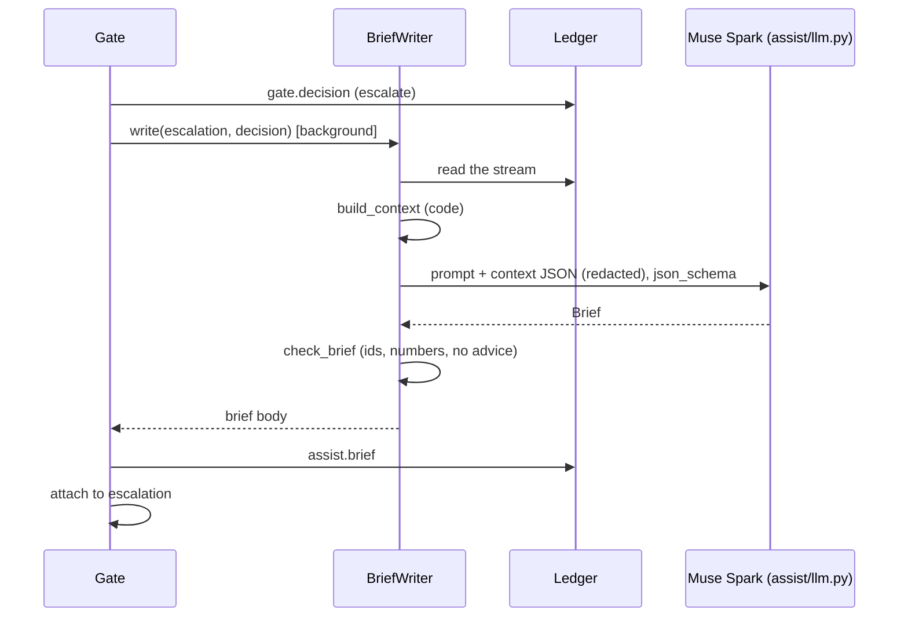

# Assist (`assist/`): the model entry point and approval briefs

Guarantees that every model call goes through one function, to a Meta model in Standard mode, and comes back as a validated schema or not at all. Approval briefs say only what code found in the ledger: every cited record and every number is checked against that context before Gate records the brief, and a brief never decides.

Status: done for this step: `assist/llm.py`, approval briefs, and auditor Q&A (beat 3) with every claim proven by [`claims/`](claims.md). Not yet run against the real Meta Model API: no key was set (see [`../MODELS.md`](../MODELS.md)). · Last updated: 2026-10-28 · Tests: 51 unit (`test_assist_llm.py` 18, `test_assist_brief.py` 19, `test_assist_auditor.py` 8, `test_assist_evidence.py` 6) plus 2 `live` tests skipped by default, and 1 Postgres integration test. Coverage: `assist/llm.py` 92%, `assist/brief.py` 99%, `assist/auditor.py` 98%, `assist/evidence.py` 100%.

Related pages: [`gate.md`](gate.md) (escalations, the `BriefWriter` port), [`../MODELS.md`](../MODELS.md) (model IDs, prices, parameters).

## Responsibilities

Owns:

| Part | File |
| --- | --- |
| The only model entry point: routes, profiles, structured output, retries, redaction, call log | `assist/llm.py` |
| Brief context from the ledger, `Brief` schema, grounding checks, `BriefWriter` | `assist/brief.py` |
| The brief prompt, versioned | `assist/prompts/approval_brief.md` |
| Auditor Q&A: query, rows, answer, claim check, `assist.qa` | `assist/auditor.py`, `assist/prompts/auditor_query.md`, `assist/prompts/auditor_answer.md` |
| Reading records and evidence from the ledger API | `assist/evidence.py` |

Does not own:

- **Deciding.** Gate decided before the brief exists, and only a person closes the escalation (R2).
- **Recording the brief.** Gate signs and appends it as `assist.brief` and links it to the escalation; see [`gate.md`](gate.md).
- **Proving claims.** That is [`claims/`](claims.md); the auditor only shows what it accepts.

## How it works

1. Gate decides `escalate`, records the decision and opens the escalation. If a `BriefWriter` is configured, Gate starts it in the background: the decision never waits on a model.
2. `build_context` reads the stream from the ledger and computes, in code:
   - the decision: agent, tool, action, matched policies, required roles, expiry;
   - the facts, with the amount as `$48,000.00`;
   - the agent's payments in the last 30 days: count, median, largest (with its record id), and up to 8 record ids;
   - the payee's history: earlier decisions, earlier approvals, and their record ids;
   - whether it is outside business hours (Mon–Fri 09:00–16:59, bank time).
3. Muse Spark gets the prompt and that JSON, and returns a `Brief`: a headline, one to four "unusual" points each citing record ids, and up to three things the approver could check.
4. `check_brief` rejects the brief if any point cites an id not in the context or cites none, if any text has a number not in the context (or a record id in the text), or if it recommends a verdict. The model gets one retry with the problems; a second failure means no brief.
5. Gate appends the brief as `assist.brief`, attaches it to the escalation, and the approver sees it in `GET /gate/v1/escalations`. The verdict record names the brief the approver could see (`brief_record_id`).



### Auditor Q&A (beat 3)

1. Muse Spark turns the question into a `RecordQuery` (filters only).
2. Code reads the stream's export and runs the query: each `gate.decision` joined with its `gate.verdict`, newest first, at most 50 rows.
3. Muse Spark answers from those rows with claims (text, record ids, assertions). Ids outside the rows get one retry.
4. `claims.checker` proves each claim against the latest final checkpoint (see [`claims.md`](claims.md)).
5. The answer text uses only accepted claims; rejected ones are listed with reasons.
6. The audit is appended as `assist.qa`, signed by `assist-1`.

`--inject-fault` (demo) makes the first assertion of the first claim false and marks it injected, so the video can show a wrong claim being caught on demand.

## Interfaces

| Function / class | Input | Output | Errors |
| --- | --- | --- | --- |
| `ModelConfig(profile, routes, timeout_seconds, call_log)` | profile `cloud` or `onprem`; role → `Route(model, api_base, api_key)` | validated config | `config.model_profile`, `config.contributor_mode`, `config.model_route` |
| `LlmClient.complete_structured(model_role, schema, messages, *, prompt_version, check=None)` | role (`spark`, `wonder`), Pydantic model, messages | parsed `schema` instance | `model.bad_output` (twice invalid), `model.unavailable` (after 3 attempts), `model.refused` (any other provider error), `config.model_route`, `config.model_schema` |
| `redact(text)` | text | 10+ digits (with optional single separators) or 8+ in a row → `[redacted]` | |
| `strict_json_schema(model)` | Pydantic model | JSON schema in Meta's strict subset | `config.model_schema` |
| `build_context(escalation, decision, history)` | escalation, the decision `Receipted`, raw stream records | `BriefContext(data, record_ids)` | |
| `check_brief(brief, context)` | | list of problems | |
| `BriefWriter(llm, history).write(escalation, decision)` | | `assist.brief` record body | `ModelOutputError` (Gate logs it and records no brief) |
| `Auditor(llm, reader, trust, recorder, clock=, timezone=).ask(question, inject_fault=False)` | question (≤ 500 chars) | `AuditResult(query, rows, summary, results, injected, record)`, `.answer_text()` | `ModelOutputError` (model or ledger unavailable, invalid twice) |
| `run_query(query, records, now)`, `build_rows(records)` | | rows | |
| `HttpLedgerReader(base, http, stream, final=True)` | | `records()`, `final_size()`, `evidence(id, size)` | `audit.ledger_unavailable` |
| `LedgerRecorder(...).record(body)` | | receipted `assist.qa` | ledger errors |

## Data

`assist.brief` (signed by `gate-1`, appended by Gate):

| Field | Meaning |
| --- | --- |
| `escalation_id`, `decision_record_id` | What it is about; Gate refuses a body for another escalation |
| `model`, `prompt_version` | e.g. `meta/muse-spark-1.3`, `approval_brief/1` |
| `headline`, `unusual[{text, record_ids}]`, `approver_checks[]` | The model's text, after `check_brief` |
| `context_record_ids` | Every record id the context offered, so an auditor can see what the model had |

The `escalation` table gains `brief_record_id`, which can be set once in any state; the guard trigger refuses a change after that. `gate.verdict` gains `brief_record_id`.

`assist.qa` (signed by `assist-1`): `question`, `query`, `rows`, `model`, `prompt_versions`, `answer` (the shown text), `claims[{text, record_ids, accepted, reasons, injected}]`, `asked_at`.

Files: `logs/model_calls.csv` (see [`../MODELS.md`](../MODELS.md)).

## Security and failure behaviour

| Failure or attack | What happens | Test |
| --- | --- | --- |
| A Contributor-mode model ID anywhere in the config | Refused at startup | `test_contributor_mode_models_are_refused` |
| A non-Meta model on the cloud profile | Refused at startup | `test_unknown_profiles_and_non_meta_cloud_routes_are_refused` |
| Any other file imports `litellm`, `openai` or `anthropic` | Test fails | `test_litellm_is_imported_only_by_the_model_entry_point` |
| Account or routing numbers in a message | Masked before sending | `test_digits_that_could_be_account_numbers_never_leave` |
| Prompt text in logs | Only its SHA-256 | `test_a_valid_answer_is_parsed_and_logged` |
| Output that is not the schema | One retry with the errors, then `model.bad_output` | `test_one_retry_...`, `test_a_second_invalid_answer_fails_closed` |
| Brief cites a record that is not in the context | Rejected | `test_briefs_that_invent_or_decide_are_rejected` |
| Brief invents a number ($50,000, 400%) | Rejected | same |
| Brief recommends approving or rejecting | Rejected | same |
| Model rate-limited or down | Backoff, then `model.unavailable`; no brief; the escalation is unaffected | `test_rate_limits_...`, `test_a_failed_brief_changes_nothing_but_the_brief` |
| Writer returns a brief for another escalation | Gate refuses it | same |
| Model hangs | `MODEL_TIMEOUT_SECONDS`; the decision was already returned | Gate runs briefs in the background |

What it does not protect against:

- **Misleading wording with true facts.** The checks cover ids, numbers and verdict advice, not tone. The approver still sees the raw facts and policy ids beside the brief.
- **History read from the database, not proofs.** `build_context` uses records as stored. A tampered row would show in the brief and be caught by `pl-verify`; briefs do not verify inclusion proofs (the claim checker will, for auditor answers).
- **Number matching by value.** A number that happens to appear elsewhere in the context (an hour, a policy id digit) passes in any sentence.

## Formulas and formats

No hashing or signing of its own; `assist.brief` is an ordinary v1 record signed by Gate. The prompt hash in the call log is SHA-256 of `json.dumps(messages, sort_keys=True)`, a log key only.

## How to run and test

```sh
make check                                     # includes test_assist_*.py, all faked
META_API_KEY=... uv run pytest -m live -s      # one real brief from Muse Spark
```

With `META_API_KEY` in `.env`, `make gate` starts with briefs on (its log says `"briefs": true`, and `/gate/v1/health` reports it), and `make demo-gate` prints the brief before approving. Without a key, Gate runs exactly as before with `"briefs": false`. `GATE_BRIEFS=false` turns them off.

## Decisions

[D56](../DECISIONS.md) the model entry point · [D57](../DECISIONS.md) briefs grounded in code-built context · [D58](../DECISIONS.md) briefs as ledger records, off the decision path · [D59](../DECISIONS.md) `litellm` version and hygiene · [D60](../DECISIONS.md) auditor Q&A built with `claims/` · [D63](../DECISIONS.md) query then answer · [D64](../DECISIONS.md) answer text, fault injection, `assist.qa`.

## Known gaps

- No live run yet (no key). The parameters come from Meta's docs and LiteLLM's model table.
- On-prem profile configured but never run.
- History is the whole stream read on each brief, which is fine at demo scale. A query by agent and payee is needed before production.
- No spend cap: the call log shows spend, nothing stops it.
