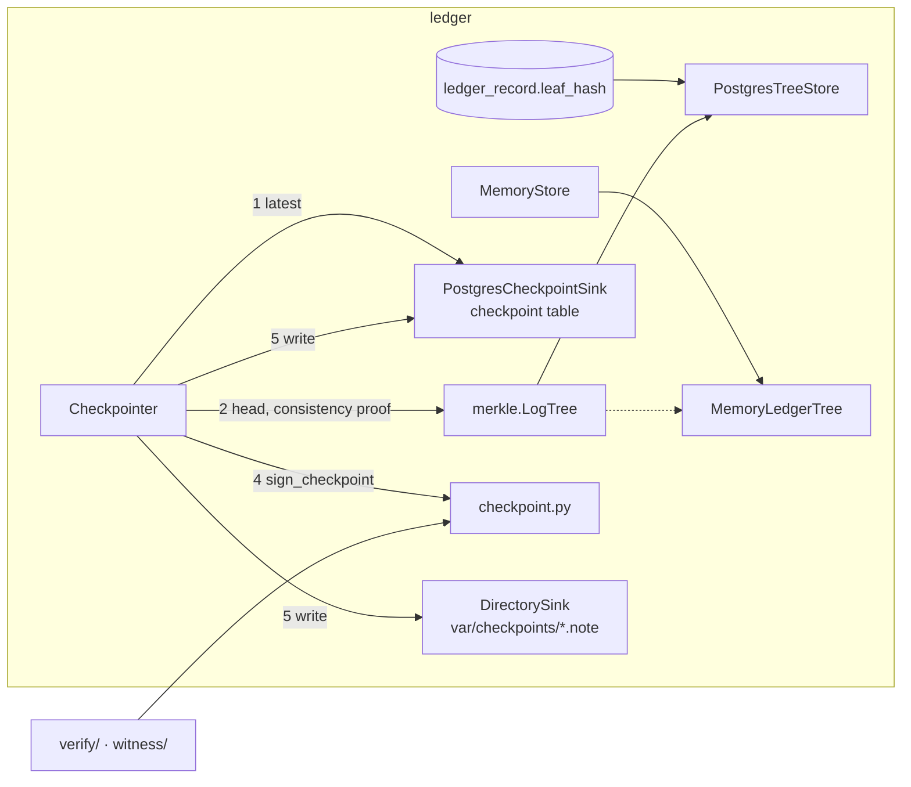

# Checkpoints

Guarantees that each stream's Merkle tree head (size and root) is published as a C2SP checkpoint signed by the log key, stored write-once, and never signed for a history that does not extend the previous checkpoint.

Status: done for this step (format, signing, checkpointer, directory and Postgres sinks, Postgres tree adapter). The 10-second loop and the HTTP endpoint are in [`api.md`](api.md); cosignatures and finality are in [`witness.md`](witness.md). · Last updated: 2026-10-27 · Tests: 66 unit + property (`checkpoint.py` and `checkpointer.py` 100% lines and branches) plus 2 vector checks and import-boundary checks that keep `checkpoint.py` pure; 7 integration (`pg_tree.py` 100%)

Part of `ledger/`; see [`ledger.md`](ledger.md) for records and receipts and [`merkle.md`](merkle.md) for the tree.

## Responsibilities

Owns:

- The checkpoint text and the signed-note envelope, Ed25519 only (`ledger/checkpoint.py`). Pure, so the verifier and witnesses can import it (D28).
- The `Checkpointer`, which reads the tree through a `TreeStore` adapter, checks consistency with its last checkpoint, signs, and writes to every sink (`ledger/checkpointer.py`).
- The `CheckpointSink` port and two adapters: `DirectorySink` (one read-only file per tree size) and `PostgresCheckpointSink` (the `checkpoint` table).
- `TreeStore` adapters over ledger data: `MemoryLedgerTree` (`store.py`) and `PostgresTreeStore` (`pg_tree.py`).

Does not own:

- Merkle hashing and proofs (`merkle/`).
- Cosignatures and the 2-of-3 quorum. See [`witness.md`](witness.md). A checkpoint here is signed by the log only; it becomes final when two witnesses cosign it.
- Scheduling. `Checkpointer.publish()` is one call; the background task that calls it every 10 seconds comes with the API.

## How it works

1. The checkpointer reads the latest stored note from its first sink and verifies it under its own key. A stored note it cannot verify stops it (R4).
2. It reads the current tree head through the `TreeStore` adapter. For the ledger, leaf `i` is the `leaf_hash` of the record at `seq = i + 1`.
3. If there is a previous checkpoint, it checks that the new tree extends it: same size needs the same root, larger size needs a valid RFC 9162 consistency proof, smaller size is refused.
4. It signs the checkpoint body as a signed note, with the stream's origin as the key name.
5. It writes the note to every sink, every time. Ed25519 is deterministic, so re-signing an unchanged head gives an identical note, and writing it again is a no-op. A sink that was down last time catches up on the next call.



## Interfaces

| Function / class | Input | Output | Errors |
| --- | --- | --- | --- |
| `Checkpoint(origin, size, root, extensions=())` | | frozen dataclass | |
| `Checkpoint.body()` | | checkpoint text | `FormatError checkpoint.malformed` |
| `parse_checkpoint(body)` | text | `Checkpoint` | `checkpoint.malformed` |
| `NoteKey(name, public_key_raw)` | key name, 32-byte key | key with `.key_hash`, `.verifier()` | `note.bad_key` |
| `NoteKey.from_verifier(text)` | `name+hash+base64` | `NoteKey` | `note.bad_key` (also on a wrong key hash) |
| `sign_note(text, signer, name)` | text, any `NoteSigner` | signed note | `note.malformed`, `note.bad_key` |
| `open_note(note, keys)` | note, trusted keys | `(text, names that verified)` | `FormatError note.malformed`, `note.duplicate_signature`; `SignatureError note.bad_signature`, `note.unverified` |
| `sign_checkpoint(cp, signer)` | | signed note, key name = origin | as `sign_note` |
| `open_checkpoint(note, log_key)` | | `Checkpoint` | as `open_note`, plus `checkpoint.malformed`, `SignatureError checkpoint.wrong_origin` |
| `origin_for(base, stream)` | `precept-ledger.local`, `harbor-federal/decisions` | `precept-ledger.local/harbor-federal/decisions` | |
| `Checkpointer(tree, signer, origin, sinks)` | `LogTree`, signer, origin, at least one sink | | `LedgerError checkpoint.no_sink` |
| `await Checkpointer.publish()` | | `SignedCheckpoint(checkpoint, note)` | `LedgerError checkpoint.inconsistent`, `checkpoint.conflict`; `SignatureError` for an unverifiable stored note; `StoreError` from a sink or adapter |
| `CheckpointSink.write(signed)`, `.latest()` | | `None`, newest note or `None` | `checkpoint.conflict`, `StoreError` |
| `MemoryStore.tree(stream)`, `PostgresStore.tree(stream)` | stream | `TreeStore` adapter | `StoreError store.gap` (Postgres) |
| `PostgresStore.checkpoint_sink(stream)` | stream | `PostgresCheckpointSink` | |

## Data

| Where | Content | Write rule |
| --- | --- | --- |
| `checkpoint` table | `stream`, `tree_size`, `root_hash` (base64), `note` (full signed note). Primary key `(stream, tree_size)` | Insert only. Triggers reject UPDATE, DELETE and TRUNCATE; `pl_app` has INSERT and SELECT. `tree_size` and `root_hash` are copies for queries. Only `note` is trusted, and it is verified before use |
| `CHECKPOINT_DIR` (default `var/checkpoints`, git-ignored) | `00000000000000000004.note`: the signed note for tree size 4, zero-padded to 20 digits so names sort by size | Created with `open("x")`, then `chmod 0444`. Rewriting identical bytes is allowed; different bytes raise `checkpoint.conflict` |
| Reads | `ledger_record.seq`, `ledger_record.leaf_hash` for one stream | Read only |

Settings: `LEDGER_ORIGIN` (default `precept-ledger.local`) and `CHECKPOINT_DIR`, both in `.env.example`.

## Security and failure behaviour

| Threat or failure | Behaviour | Test |
| --- | --- | --- |
| Admin bypasses the triggers and rewrites a `leaf_hash` | The next publish finds no consistency proof from the signed checkpoint and refuses: `checkpoint.inconsistent` | `test_admin_rewrite_of_a_leaf_is_refused_at_the_next_checkpoint` (Postgres) |
| History rewritten (same size, grown or truncated) | Refused, nothing written | `test_refuses_to_sign_a_history_inconsistent_with_the_last_checkpoint` (4 cases) |
| Admin deletes a record row | Adapter sees a seq gap, raises `StoreError store.gap`, no checkpoint | `test_gap_from_a_deleted_row_fails_closed` |
| Two different checkpoints for one size (split view) | Second write refused, file and row untouched: `checkpoint.conflict` | `test_directory_sink_is_write_once`, `test_conflicting_checkpoint_for_a_size_is_refused` |
| Stored previous checkpoint forged under another key | `SignatureError`; it is never used as the base | `test_previous_checkpoint_signed_by_another_key_fails_closed` |
| Any single-byte edit of a signed checkpoint | `FormatError` or `SignatureError` | `test_any_single_byte_edit_of_a_signed_checkpoint_fails` (300 examples) |
| Bad signature from a trusted key, or no trusted signature | Whole note rejected (`note.bad_signature`, `note.unverified`); signatures from unknown keys are ignored | `test_bad_signature_from_a_known_key_is_rejected`, `test_signatures_from_unknown_keys_are_ignored` |
| Receipt signature replayed as a checkpoint signature (same log key) | Impossible: receipt and record signing inputs contain NUL, which note text may not contain (D28) | `test_other_signed_payloads_can_never_be_note_text` |
| Checkpoint for another log presented under our key | `checkpoint.wrong_origin` | `test_open_checkpoint_requires_the_origin_to_match_the_key_name` |
| Database or a sink down | `StoreError`; the publish fails, and the next publish rewrites every sink | `test_sink_failure_fails_the_publish_and_the_next_publish_heals`, `test_unreachable_database_fails_closed` |
| Oversized or malformed notes | Rejected: more than 64 KiB, more than 32 signature lines, blank lines, control characters, non-canonical base64 | `test_open_rejects_malformed_notes`, `test_limits_and_encoding_edge_cases` |

What it does not protect against: an operator who holds the log key and runs their own signing code. They can sign any tree. The consistency self-check only stops the honest process from signing a rewritten table. Witnesses are the check that holds against a rogue operator (demo beat 5, [`witness.md`](witness.md)).

## Formulas and formats

| Item | Definition |
| --- | --- |
| Checkpoint body (C2SP tlog-checkpoint) | `<origin>\n<tree size, decimal, no leading zeros>\n<base64 root>\n[<extension line>\n]*` |
| Origin | `<LEDGER_ORIGIN>/<stream>`; it is also the signed-note key name |
| Key hash | `SHA-256(name ‖ "\n" ‖ 0x01 ‖ 32-byte Ed25519 public key)[0:4]` |
| Verifier key | `<name>+<hex key hash>+<base64(0x01 ‖ public key)>` |
| Signature | `Ed25519(log key, UTF-8 note text)`, with no prefix (C2SP); domain separation comes from the NUL rule (D28) |
| Signed note | `<text>\n— <name> <base64(key hash ‖ 64-byte signature)>\n` (em dash U+2014, then a space) |
| Text rules | Non-empty, ends with `\n`, no blank lines, no Unicode control characters (C0, DEL, C1) except `\n`, valid UTF-8 |

Worked example from `tests/vectors/checkpoint-v1.json`. It is a checkpoint over the three records in `ledger-v1.json`, signed by the TEST ONLY log key:

```text
precept-ledger.local/harbor-federal/decisions
3
XId9QnIn93Thb1lnOkqdn7CEMh2Ue7bbju3LcNFwOgs=

— precept-ledger.local/harbor-federal/decisions QkQNiu7O5t50ohHXJQ313xp2fHXgSDLMnDItQ6iF67SmRCD/8CFlJw4plGV3RYi4+Cu5gx+wSqw8CnUVkIF0VMBG+Ao=
```

Verifier key: `precept-ledger.local/harbor-federal/decisions+42440d8a+ATNFjeFtxAmLWjjvUBp2BltAA+wkmjYHI7CxXFvHpscV`. The signature's first 4 bytes, `QkQNig==` in base64, are the key hash `42440d8a`. `test_checkpoint_vector_independently` re-checks the root, key hash and signature using only `hashlib`, `base64` and `cryptography`.

External check: `tests/vectors/signed-note-published.json` holds the example from the Go `golang.org/x/mod/sumdb/note` documentation. The verifier key is `PeterNeumann+c74f20a3+…`. Our code parses it, recomputes key hash `c74f20a3`, and verifies the published signature (D29).

## How to run and test

```sh
uv run pytest tests/unit/test_checkpoint.py tests/unit/test_checkpointer.py tests/property/test_checkpoint_properties.py
make test-integration   # re-applies ledger/schema.sql (make db-schema), then 14 Postgres tests
make vectors            # regenerates checkpoint-v1.json; a diff means the format changed
```

Using it in code:

```python
tree = LogTree(store.tree(stream))
sinks = [store.checkpoint_sink(stream), DirectorySink(settings.checkpoint_dir / stream)]
checkpointer = Checkpointer(tree, log_signer, origin_for(settings.ledger_origin, stream), sinks)
signed = await checkpointer.publish()
```

## Decisions

D4 (C2SP formats), D16 (leaf index = seq − 1), D19 (canonical base64), D25 (merkle port), D28, D29, D30 in [`docs/DECISIONS.md`](../DECISIONS.md).

## Known gaps

- The checkpointer takes its previous checkpoint from the first sink only. If the sinks disagree, the other sinks report it only when a write conflicts.
- `LogTree` reads every leaf on each publish (O(n)), which is fine at demo scale (see `merkle.md`).
- One log key signs receipts and checkpoints for every stream. The key hash differs per stream because the key name is the origin.
