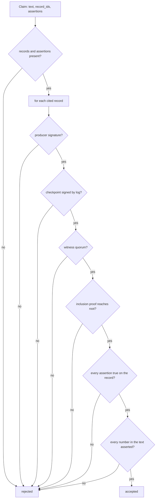

# Claims (`claims/`): a model's claim is shown as true only if it is proven

Guarantees that every claim a model makes about the ledger is checked, deterministically and offline, before anyone sees it as true: each cited record must be signed by its trusted producer and proven by a Merkle inclusion proof into a checkpoint that the log signed and the witnesses cosigned, and each field assertion must hold on that record exactly.

Status: done for this step. Used by auditor Q&A (beat 3, [`assist.md`](assist.md)); the learner (`learn/`) and the watchdog will use the same checker. · Last updated: 2026-10-28 · Tests: 21 unit (`tests/unit/test_claims_checker.py`) against the real ledger API with three witnesses, plus 8 auditor tests that run it end to end. Coverage: `claims/checker.py` 95%.

Related pages: [`verify.md`](verify.md) (the same checks over a whole bundle), [`merkle.md`](merkle.md) (inclusion proofs), [`witness.md`](witness.md) (finality).

## Responsibilities

Owns `claims/checker.py`: the `Claim`, `Assertion`, `Evidence` and `Trust` types, `check_record`, `check_claims` and `resolve`.

Does not own:

- **Fetching evidence.** `assist/evidence.py` gets records and proofs from the ledger API. The checker trusts none of it.
- **Writing claims.** Muse Spark does, in `assist/auditor.py`.
- **Trust.** The keys come from the auditor's `trusted.json` and `witnesses.txt`, the same files `pl-verify` takes.

It imports only what the verifier may (skill §2): `ledger.format`, `ledger.checkpoint`, `ledger.cosignature`, `merkle.proofs`, `verify.keys`, `common.errors`. The import test enforces this; no network, no model.

## How it works

For each claim, in order:

1. A claim with no cited record or no assertion is rejected.
2. Each cited record is checked once, and the result is reused across claims:
   1. evidence exists; the record parses as format v1 and is the record cited;
   2. its producer's trusted key signed it (`TrustedKeys.check_producer`);
   3. the checkpoint note verifies under a trusted log key for the expected origin;
   4. the note carries at least the quorum of valid witness cosignatures (final);
   5. the proof is for this record's index (`seq − 1`) and this checkpoint's size;
   6. the RFC 9162 inclusion proof from `SHA-256(0x00 ‖ JCS(record))` reaches the checkpoint root.
3. Only if every cited record is proven are assertions read. Each must name a cited record, a field path inside it, and an operator; it must hold exactly.
4. Every number in the claim's text must be one an assertion establishes. That is the asserted value, the dollar form of a `*_cents` value, or a digit inside an asserted string such as a timestamp.



## Interfaces

| Function / type | Input | Output |
| --- | --- | --- |
| `Assertion(record_id, field, op, value)` | `op` in `eq ne gt gte lt lte`; `value` str, int, bool or null | |
| `Claim(text, record_ids, assertions)` | | |
| `Evidence.from_api(record, proof)` | `GET /ledger/v1/records/{id}` → `record`, and `GET …/proof?size=N` | `Evidence(record, leaf_index, tree_size, hashes, checkpoint)` |
| `Trust(keys, origin, witnesses)` | `TrustedKeys`, checkpoint origin, `WitnessPolicy` or `None` | |
| `check_record(record_id, evidence, trust)` | | `None`, or why it is not proven |
| `check_claims(claims, evidence, trust)` | claims, evidence by record id | `ClaimResult(claim, accepted, reasons)` per claim |
| `resolve(record, path)` | dotted path from `body`, `producer`, `type`, `ts`, `record_id`, `seq` or `stream`; up to 7 parts | `(found, value)` |

Comparison rules: `eq`/`ne` need the same JSON type (`true` is not `1`, `1` is not `"1"`), and objects and lists are not comparable. `gt`/`gte`/`lt`/`lte` need two integers; anything else is "cannot compare", which rejects. Paths never index into lists and never leave the record.

Reason strings name the record id first, for example `01M6…: body.approver eq 'm.lee' is false (record has 'j.ortiz')` or `01M6…: checkpoint not final (2 of 3 cosignatures)`.

## Data

Reads only what it is handed. Writes nothing.

## Security and failure behaviour

| Attack or failure | Result | Test |
| --- | --- | --- |
| Wrong value (approver, amount) | Rejected, with the real value | `test_a_wrong_assertion_rejects_the_claim` |
| `true` asserted as `1`, a string compared with `gt` | Rejected | same |
| Field that does not exist | Rejected | same |
| Unknown record id | Rejected (`no evidence`) | `test_an_unknown_record_id_rejects_the_claim` |
| Assertion on a record the claim does not cite | Rejected | `test_an_assertion_about_an_uncited_record_is_rejected` |
| Right assertions, invented number in the text | Rejected | `test_a_number_in_the_text_must_be_asserted` |
| Edited record (evidence altered after the fact) | Inclusion proof fails | `test_evidence_that_does_not_prove_the_record_rejects_the_claim[edited field]` |
| Altered proof hash, wrong index | Rejected | `[wrong proof hash]`, `[wrong leaf index]` |
| Forged checkpoint | Log signature fails | `[forged checkpoint]` |
| Checkpoint below the witness quorum | Rejected as not final | `test_a_checkpoint_below_the_witness_quorum_is_not_trusted` |
| Record from an untrusted producer | Rejected | `test_records_from_an_untrusted_producer_are_rejected` |
| Record after the checkpoint | Rejected | `test_a_record_not_yet_checkpointed_cannot_be_proven` |
| One wrong claim among right ones | Only that claim rejected | `test_each_claim_is_judged_on_its_own` |

What it does not prove:

- **That the claim answers the question.** A true, proven claim can still be beside the point. The answer text uses only accepted claims, and the examiner sees which rows the query returned.
- **Absence.** "No other payment matched" is not a claim the checker can prove; completeness of the query rests on the code-run query over the whole export, which `pl-verify` can check separately.
- **Words.** A name or payee in the text that no assertion covers is not checked; numbers are.

## Formulas and formats

Uses the ledger's own: leaf `SHA-256(0x00 ‖ JCS(record))`, RFC 9162 inclusion proofs, C2SP signed checkpoints and `cosignature/v1` (see [`../modules/README.md`](README.md), "Signing contexts in use"). It adds none.

## How to run and test

```sh
uv run pytest tests/unit/test_claims_checker.py tests/unit/test_assist_auditor.py
make demo-audit                      # against make serve; needs META_API_KEY
make demo-audit ARGS="--inject-fault"
```

## Decisions

[D61](../DECISIONS.md) what a proven claim is · [D62](../DECISIONS.md) numbers in the text · plus D21 (records rebuilt from columns), D41 (finality), D42 (quorum from the auditor's file).

## Known gaps

- Names and other words in claim text are not checked, only numbers.
- No proof of absence or completeness.
- Evidence is fetched per record (two requests each); fine for a page of claims.
