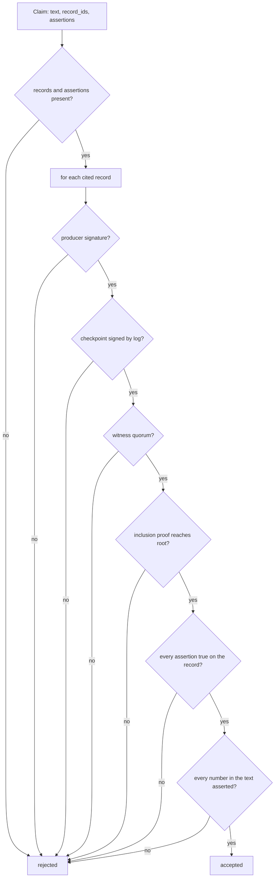

# Claims (`claims/`): a model's claim is shown as true only if it is proven

Guarantees that every claim a model makes about the ledger is checked, deterministically and offline, before anyone sees it as true. Each cited record must be signed by its trusted producer and proven to be under a checkpoint that the log signed and the witnesses cosigned. Each field assertion must hold on that record exactly. Every number and name in the claim's text, and in the answer's summary, must be one an assertion establishes. For questions about "every" record, the whole export is proven up to the final checkpoint and the query runs in code over that proven prefix.

Status: done for this step. Used by auditor Q&A (beat 3, [`assist.md`](assist.md)); the learner (`learn/`) and the watchdog will use the same checker. · Last updated: 2026-10-28 · Tests: 31 unit (`test_claims_checker.py` 24, `test_claims_log.py` 7) against the real ledger API with three witnesses, plus 9 auditor tests that run it end to end. Coverage: `claims/checker.py` 96%, `claims/log.py` 96%, `claims/query.py` 97%.

Related pages: [`verify.md`](verify.md) (the same checks over a whole bundle), [`merkle.md`](merkle.md) (inclusion proofs), [`witness.md`](witness.md) (finality).

## Responsibilities

Owns:

| Part | File |
| --- | --- |
| `Claim`, `Assertion`, `Evidence`, `Trust`; `check_record`, `check_claims`, `check_claims_in_log`, `check_summary`, `unbacked_names`, `resolve` | `claims/checker.py` |
| `ProvenLog`, `prove_log`: the export verified up to the final checkpoint | `claims/log.py` |
| `Query`, `build_rows`, `run_query`: the auditor's read-only query, run by code | `claims/query.py` |

Does not own:

- **Fetching evidence.** `assist/evidence.py` gets the export from the ledger API; tests and other callers fetch per-record proofs. The checker trusts none of it.
- **Choosing the query.** Muse Spark picks the filters (`assist.auditor.RecordQuery`); code runs them here.
- **Writing claims.** Muse Spark does, in `assist/auditor.py`.
- **Trust.** The keys come from the auditor's `trusted.json` and `witnesses.txt`, the same files `pl-verify` takes.

It imports only verifier-side code: `ledger.format`, `ledger.checkpoint`, `ledger.cosignature`, `merkle.proofs`, `verify.keys`, `verify.bundle`, `verify.checks`, `common.errors`, `common.clock`. The import test enforces the ledger side of this; no network, no model. Skill §2 names a narrower list (`ledger.format`, `ledger.merkle`); see Known gaps.

## How it works

For each claim, in order:

1. A claim with no cited record or no assertion is rejected.
2. Each cited record is checked once, and the result is reused across claims:
   1. evidence exists; the record parses as format v1 and is the record cited;
   2. its producer's trusted key signed it (`TrustedKeys.check_producer`);
   3. the checkpoint note verifies under a trusted log key for the expected origin;
   4. the note carries at least the quorum of valid witness cosignatures (final);
   5. the proof is for this record's index (`seq − 1`) and this checkpoint's size;
   6. the RFC 9162 inclusion proof from `SHA-256(0x00 ‖ JCS(record))` reaches the checkpoint root.
3. Only if every cited record is proven are assertions read. Each must name a cited record, a field path inside it, and an operator; it must hold exactly.
4. Every number in the claim's text must be one an assertion establishes. That is the asserted value, the dollar form of a `*_cents` value, or a digit inside an asserted string such as a timestamp.
5. Every name-like token in the text (letters and digits joined by `.`, `-` or `_`, any case: `j.ortiz`, `northwind-supply`, `create_payment`) must equal an asserted string value or a token inside one.

### The proven log (auditor questions)

Per-record proofs show a record is in the log, not that nothing else matched. For a question like "every payment over $10,000 approved outside business hours", `prove_log` runs `pl-verify`'s checks (`verify_bundle`) on the whole export:

1. The bundle's origin must be the trusted origin.
2. Chain, producer signatures, receipts and checkpoints against the records must all verify, with the witness quorum. Any finding rejects the whole log, except `below_quorum` on a checkpoint newer than the final one (normal while witnesses catch up).
3. Records `1..size` of the latest final checkpoint are the proven log. Newer records are counted (`newer`) and left out.

`run_query` then runs over the proven records only, and `check_claims_in_log` checks each claim against them: a cited record must be in the prefix, and its place under the verified root is its inclusion proof. `check_summary` checks the answer's summary the same way, against the accepted claims' assertions plus the counts code computed.



## Interfaces

| Function / type | Input | Output |
| --- | --- | --- |
| `Assertion(record_id, field, op, value)` | `op` in `eq ne gt gte lt lte`; `value` str, int, bool or null | |
| `Claim(text, record_ids, assertions)` | | |
| `Evidence.from_api(record, proof)` | `GET /ledger/v1/records/{id}` → `record`, and `GET …/proof?size=N` | `Evidence(record, leaf_index, tree_size, hashes, checkpoint)` |
| `Trust(keys, origin, witnesses)` | `TrustedKeys`, checkpoint origin, `WitnessPolicy` or `None` | |
| `check_record(record_id, evidence, trust)` | | `None`, or why it is not proven |
| `check_claims(claims, evidence, trust)` | claims, evidence by record id | `ClaimResult(claim, accepted, reasons)` per claim |
| `resolve(record, path)` | dotted path from `body`, `producer`, `type`, `ts`, `record_id`, `seq` or `stream`; up to 7 parts | `(found, value)` |
| `prove_log(bundle, trust)` | `verify.bundle.Bundle` | `ProvenLog(stream, size, root, records, newer)` or why not |
| `check_claims_in_log(claims, log)` | claims, `ProvenLog` | `ClaimResult` per claim |
| `check_summary(summary, results, numbers=(), names=())` | summary text, the claim results, counts from code, ids code supplied (rule ids); digits inside a supplied id are not read as numbers | list of problems |
| `unbacked_names(text, assertions, names=())` | | names not established |
| `Query(...)`, `run_query(query, records, now)`, `build_rows(records)` | proven records | every matching row, newest first (the caller cuts to `MAX_ROWS` = 50) |

Comparison rules: `eq`/`ne` need the same JSON type (`true` is not `1`, `1` is not `"1"`), and objects and lists are not comparable. `gt`/`gte`/`lt`/`lte` need two integers; anything else is "cannot compare", which rejects. Paths never index into lists and never leave the record.

Reason strings name the record id first, for example `01M6…: body.approver eq 'm.lee' is false (record has 'j.ortiz')` or `01M6…: checkpoint not final (2 of 3 cosignatures)`.

## Data

Reads only what it is handed. Writes nothing.

## Security and failure behaviour

| Attack or failure | Result | Test |
| --- | --- | --- |
| Wrong value (approver, amount) | Rejected, with the real value | `test_a_wrong_assertion_rejects_the_claim` |
| `true` asserted as `1`, a string compared with `gt` | Rejected | same |
| Field that does not exist | Rejected | same |
| Unknown record id | Rejected (`no evidence`) | `test_an_unknown_record_id_rejects_the_claim` |
| Assertion on a record the claim does not cite | Rejected | `test_an_assertion_about_an_uncited_record_is_rejected` |
| Right assertions, invented number in the text | Rejected | `test_a_number_in_the_text_must_be_asserted` |
| Edited record (evidence altered after the fact) | Inclusion proof fails | `test_evidence_that_does_not_prove_the_record_rejects_the_claim[edited field]` |
| Altered proof hash, wrong index | Rejected | `[wrong proof hash]`, `[wrong leaf index]` |
| Forged checkpoint | Log signature fails | `[forged checkpoint]` |
| Checkpoint below the witness quorum | Rejected as not final | `test_a_checkpoint_below_the_witness_quorum_is_not_trusted` |
| Record from an untrusted producer | Rejected | `test_records_from_an_untrusted_producer_are_rejected` |
| Record after the checkpoint | Rejected | `test_a_record_not_yet_checkpointed_cannot_be_proven` |
| One wrong claim among right ones | Only that claim rejected | `test_each_claim_is_judged_on_its_own` |
| Right assertions, another approver's name in the text | Rejected | `test_a_name_or_id_in_the_text_must_be_asserted` |
| Summary states a name or amount no accepted claim asserts | Summary not shown | `test_the_summary_may_use_only_what_accepted_claims_establish`, `test_a_summary_that_goes_beyond_the_claims_is_not_shown` |
| Edited record anywhere in the export | Whole log rejected; no question answered | `test_an_export_that_does_not_verify_proves_nothing`, `test_a_log_that_does_not_verify_gets_no_answer` |
| Export for another origin, untrusted producer anywhere | Whole log rejected | same |
| No checkpoint with the witness quorum | No proven log | `test_without_a_witness_quorum_nothing_is_final` |
| Records newer than the final checkpoint | Not searched, and the coverage line says how many | `test_records_after_the_final_checkpoint_are_left_out`, `test_coverage_says_what_the_query_did_not_search` |
| Cited id outside the proven prefix | Rejected | `test_claims_are_checked_against_the_proven_records` |

What it does not prove:

- **That the claim answers the question.** A true, proven claim can still be beside the point. The answer text uses only accepted claims, and the examiner sees which rows the query returned.
- **That the query matches the question.** The proven log makes the rows complete for the query that ran; whether the model chose the right filters is shown to the examiner (the query is printed and recorded), not proven.
- **Plain words.** "approved", "after hours" and other ordinary words are not checked; numbers and name-like tokens are. An honest hyphenated English word in a claim is rejected (fail closed), so the prompt asks the model to avoid them.

## Formulas and formats

Uses the ledger's own: leaf `SHA-256(0x00 ‖ JCS(record))`, RFC 9162 inclusion proofs, C2SP signed checkpoints and `cosignature/v1` (see [`../modules/README.md`](README.md), "Signing contexts in use"). It adds none.

## How to run and test

```sh
uv run pytest tests/unit/test_claims_checker.py tests/unit/test_claims_log.py tests/unit/test_assist_auditor.py
make demo-audit                      # against make serve; needs META_API_KEY
make demo-audit ARGS="--inject-fault"
```

## Decisions

[D61](../DECISIONS.md) what a proven claim is · [D62](../DECISIONS.md) numbers in the text · [D65](../DECISIONS.md) the proven log and the query in `claims/` · [D66](../DECISIONS.md) names in the text · [D67](../DECISIONS.md) the summary · plus D21 (records rebuilt from columns), D41 (finality), D42 (quorum from the auditor's file).

## Known gaps

- The whole export is read and verified for every question: fine at demo scale (thousands of records), not for a large log. A consistency proof from a previously verified checkpoint would make it incremental.
- Skill §2 lists only `ledger.format` and `ledger.merkle` for `claims/`; it now also uses `ledger.checkpoint`, `ledger.cosignature`, `verify.keys`, `verify.bundle` and `verify.checks` (all verifier-side, no network). The skill needs updating; it is read-only for me.
