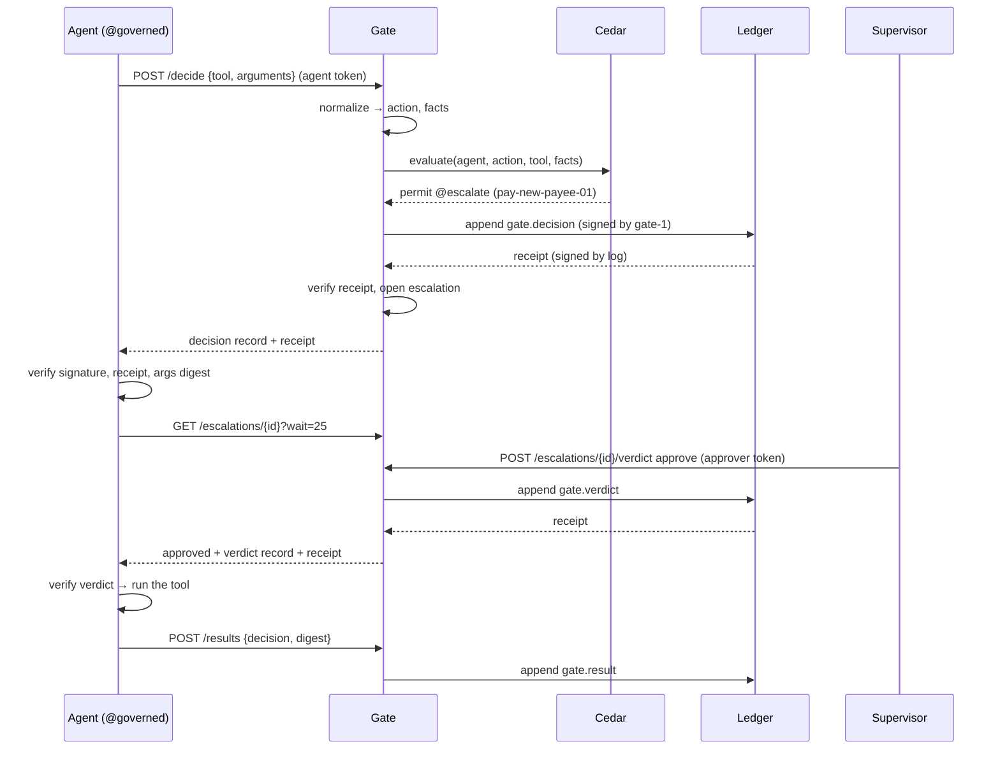

# Gate (`gate/`): decide, record, and only then let a tool run

Guarantees that an agent's tool call runs only after a signed decision record for that exact call has a verified ledger receipt, and, for a risky call, only after a person with the required role has approved it in another signed record. Cedar decides; no model is involved. Every error, timeout and unreachable dependency is a deny.

Status: done for this step. Covers delegation credentials checked before Cedar (D88, off by default with `GATE_REQUIRE_DELEGATION`), the normalizer, Cedar decisions with escalate, decision, verdict and result records, write-before-effect, the approval queue with expiry, token auth, the `/gate/v1` API (`pl-gate`), the `@governed` wrapper and demo beat 2 (`make demo-gate`). Approval briefs from `assist/` are recorded as `assist.brief` (see [`assist.md`](assist.md)). Not yet built: the MCP proxy (first on the cut list, D55), and loading the active policy set from approved `policy_rule` rows (`policy/`). · Last updated: 2026-10-29 · Tests: 185 unit across `tests/unit/test_gate_*.py` (20 of them for delegation, plus 2 delegation property tests), plus 6 integration over Postgres, 4 dev-key tests and 1 import-boundary test. Coverage: `gate/decide.py`, `normalizer.py`, `auth.py`, `records.py` and `ledger_client.py` 100%; `core.py` 97%; `api.py` 96%; `governed.py` 96%; `client.py` 95%; `delegation.py` 95%; `delegation_records.py` 94%; `escalations.py` 93%. `server.py` and `pg_escalations.py` are covered by the integration tests and the live run.

Related pages: [`ledger.md`](ledger.md) (records, producer signatures, receipts), [`api.md`](api.md) (the ledger API Gate appends to), [`verify.md`](verify.md) (offline checks of the records Gate writes).

## Responsibilities

Owns:

| Part | File | Runs in |
| --- | --- | --- |
| Tool call → action class + typed facts | `gate/normalizer.py` | Gate |
| Cedar schema for those facts | `gate/schema.cedarschema` | Gate |
| Policy-set loading and validation, allow / deny / escalate | `gate/decide.py` | Gate |
| Seed policy set for the demo bank | `deploy/policies/harbor-federal.cedar` | Gate |
| Decision, verdict and result records; record checks | `gate/records.py` | Gate, agent |
| Write-before-effect, escalations, expiry, results | `gate/core.py` | Gate |
| Escalation store port and memory store | `gate/escalations.py` | Gate |
| `escalation` table and guard trigger | `gate/schema.sql`, `gate/pg_escalations.py` | Gate database |
| Ledger client (append, read back) | `gate/ledger_client.py` | Gate |
| Agent and approver tokens | `gate/auth.py`, `KEYS_DIR/gate-callers.txt` | Gate |
| `/gate/v1` HTTP API, expiry sweep | `gate/api.py`, `gate/server.py` (`pl-gate`) | Gate |
| `@governed` wrapper and its HTTP client | `gate/governed.py`, `gate/client.py` | Agent process |
| Demo beat 2 against running servers | `scripts/demo_gate.py` (`make demo-gate`) | Developer machine |

Does not own:

- **Writing policies.** `policy/` turns the PDF into YAML, compiles it to Cedar and records the approval. Gate loads one Cedar file at start (`GATE_POLICY_FILE`). The seed file is hand-written for the demo.
- **Approval briefs.** Muse Spark writes them in `assist/`. Gate never imports a model client; a test enforces this (R2).
- **The tools themselves.** The demo agent's tools live in `agent/`. Gate decides whether they may run.
- **Storing records.** The ledger does that and signs the receipt; Gate checks the receipt.

## How it works

### Delegation credentials, before Cedar (D88)

An agent must show who authorized it, for what and until when. A principal (the team or person the agent acts for) signs a credential with Ed25519:

```json
{"credential_id": "01JB6X7Q2M9ZK3T8V4N5R6S7W0", "principal_id": "treasury.harbor-federal",
 "agent_id": "payments-ops", "action_classes": ["data.read", "value.transfer"],
 "max_amount": "5000.00", "allowed_payees": ["acme-paper", "keystone-it"],
 "not_before": "2026-10-29T20:14:03.112Z", "expires_at": "2026-11-28T21:14:03.112Z"}
```

1. **Issue.** An approver submits the principal's signed credential (`POST /gate/v1/delegations`). Gate verifies the signature against `KEYS_DIR/principals.json` and appends `gate.delegation.issue`. Agents cannot issue their own authority.
2. **Present.** The agent sends the signed credential with every call (`credential` in `/decide`; `Governor(credential=...)` does it for the agent).
3. **Check, before Cedar.** After the normalizer and before Cedar, Gate checks the credential in this order and denies on the first failure. The deny is recorded like any other, with the code, so refusals are evidence too:

| Order | Code | Fails when |
| --- | --- | --- |
| 1 | `delegation.missing` | No credential |
| 2 | `delegation.malformed` | Not the exact shape: unknown or missing field, `max_amount` not `"0.00"`-style, bad time, lifetime over 90 days, unknown action class |
| 3 | `delegation.bad_signature` | Not signed by the key `principals.json` lists for `principal_id`, any byte changed, or an `alg` other than `ed25519` |
| 4 | `delegation.not_issued` | No `gate.delegation.issue` record for this credential's hash |
| 5 | `delegation.revoked` | A `gate.delegation.revoke` record names its hash |
| 6 | `delegation.wrong_agent` | `agent_id` is not the calling agent |
| 7 | `delegation.not_yet_valid`, `delegation.expired` | Gate's clock is before `not_before`, or at or after `expires_at` |
| 8 | `delegation.out_of_scope` | The action class is not listed; for a payment, the amount is unreadable or over `max_amount`, the currency is not USD, or the payee is not listed |

4. **Cedar.** Only a call inside its delegation reaches Cedar, which still decides: a delegated payment to a new payee is still held for approval.
5. **Revoke.** The same principal signs a revocation naming the credential's id and hash (`POST /gate/v1/delegations/revocations`); Gate appends `gate.delegation.revoke`. Only the principal who granted it can take it back.

There is no delegation table. `Delegations` is a fold over Gate's own issue and revoke records: rebuilt at startup by re-reading each one through the ledger API with Gate's signature and receipt checked (a record that does not verify stops startup, because skipping a revocation would revive a credential), and updated only after a new record's receipt verifies. With `GATE_REQUIRE_DELEGATION=false` (the default until the agent carries a credential) Gate behaves as before and records `delegation: null`.

### Decide, record, run

1. The agent calls a tool wrapped with `@governor.tool("create_payment")`. The wrapper computes the argument digest and sends `{tool, arguments}` to `POST /gate/v1/decide` with its token.
2. Gate takes the agent's name from the token, not from the body. The normalizer maps the tool to an action class (`value.transfer`) and facts (`amount_cents`, `payee_new`, ...). An unmapped tool, bad arguments or an unreachable payee directory becomes a deny with that reason.
3. Cedar evaluates the facts against the active policy set. A `forbid` wins. Otherwise a matching `permit` tagged `@escalate` makes it escalate; a plain `permit` allows; no permit denies. Any Cedar error or `NoDecision` denies.
4. Gate signs a `gate.decision` record, appends it, and checks the receipt: the log's signature, and that it names this record. No verified receipt → `503` → the wrapper denies (R3).
5. **Allow.** The wrapper checks Gate's signature, the receipt, and that the record is for this agent, this tool and this argument digest. Only then does the tool run. It then reports a `gate.result` with the digest of what the tool returned.
6. **Escalate.** Gate opens an escalation, which expires at `GATE_APPROVAL_TIMEOUT_SECONDS`. The wrapper long-polls it. A supervisor sees it in `GET /gate/v1/escalations` and approves or rejects. Gate appends a `gate.verdict` record and only then closes the escalation. The wrapper checks the verdict record (signature, receipt, links to this decision, `approve`) before the tool runs.
7. **Deny, reject, expire.** The wrapper raises `GateDenied` with the reason; the tool never runs. Expiry is recorded as a `gate.verdict` with `verdict: "expire"`.



### Seed policy set (`deploy/policies/harbor-federal.cedar`)

| Rule | Effect | When |
| --- | --- | --- |
| `vendor-lookup-01` | permit | `data.read` of vendor data |
| `pay-known-payee-01` | permit | known payee and ≤ $5,000.00 |
| `pay-over-5k-01` | escalate to `payments-supervisor` | over $5,000.00 |
| `pay-new-payee-01` | escalate to `payments-supervisor` | new payee, any amount |
| `pay-usd-only-01` | forbid | currency is not USD |
| `pay-cap-01` | forbid | over $250,000.00 |
| `email-internal-01` | permit | every recipient is internal |
| `email-external-01` | escalate to `payments-supervisor` | any external recipient |

Escalating every payment over $5,000 is deliberate. Beat 6 needs a week of routine escalations (known vendors, under $15K) for the learner to propose removing.

## Interfaces

### Python

| Function / class | Input | Output | Errors |
| --- | --- | --- | --- |
| `Normalizer.normalize(tool, arguments)` | tool name, arguments | `Normalized(action, facts)` | `gate.unmapped_tool`, `gate.bad_arguments`, `gate.fact_unavailable` |
| `args_digest(arguments)` | arguments | `"sha256:<hex>"` | `gate.bad_arguments` (not I-JSON) |
| `PolicySet(text, schema)` | Cedar text, Cedar schema | validated set with `.digest`, `.rules` | `policy.syntax`, `policy.schema`, `policy.missing_id`, `policy.bad_id`, `policy.duplicate_id`, `policy.bad_annotation`, `policy.missing_approver_role`, `policy.escalate_on_forbid`, `policy.template`, `policy.empty` |
| `PolicySet.evaluate(agent, action, tool, facts)` | request | `Evaluation(outcome, reason, policy_ids, approver_roles)` | none: errors become a deny with `gate.policy_error` |
| `Gate.decide(agent, tool, arguments, *, credential=None)` | call, and the signed credential when delegation is on | `GateDecision(outcome, reason, record, escalation)` | `gate.bad_request`, `gate.ledger_unavailable`, `gate.ledger_refused`, `gate.bad_receipt`, `gate.store_unavailable` |
| `Gate.verdict(escalation_id, approver, "approve"\|"reject")` | | `Receipted` verdict record | `gate.escalation_not_found`, `gate.escalation_closed`, `gate.approver_not_allowed`, `gate.bad_request`, ledger errors |
| `Gate.status(id)`, `Gate.wait(id, seconds)` | | `Escalation` (expired first if overdue) | `gate.escalation_not_found` |
| `Gate.record_result(agent, decision_id, ok=, digest=, error=)` | | `Receipted` result record | `gate.not_cleared`, `gate.forbidden`, `gate.record_not_found`, `gate.bad_request` |
| `Gate.expire_due()` | | number expired | store errors |
| `Governor(endpoint, agent=, gate_keys=, log_keys=)` `.tool(name)` | async tool taking keyword arguments | the wrapped tool | `GateDenied(code, decision)` |
| `Governor.run_cleared(tool, arguments, effect, on_hold=None)` | as `run`; `on_hold(decision)` is called once before waiting on an escalation | `Cleared(result, decision, verdict)`, the verified records that let it run (D79; used by `agent/`) | `GateDenied`, or the effect's exception |
| `verify_receipted(item, producer_id=, producers=, log_keys=, record_type=)` | record + receipt | none | `gate.bad_record` |

| `Gate.issue_delegation(signed)`, `Gate.revoke_delegation(signed)` | the principal's signed credential or revocation | the receipted `gate.delegation.issue` / `.revoke` | `delegation.malformed`, `delegation.bad_signature`, `delegation.already_issued`, `delegation.not_issued`, `delegation.revoked`, `delegation.disabled`, Gate's ledger errors |
| `Gate.restore_delegations(records)` | the stream's raw records | how many issue and revoke records were folded | Gate's read errors (any record that does not verify) |
| `delegation.parse_credential`, `sign_credential`, `verify_signed_credential`, `credential_hash`, `check_scope`, `sign_revocation`, `verify_revocation`, `Delegations.check` | JSON, signer, principal `KeyRing` | parsed values, hashes, `Checked(code, credential)` | `GateError` with a `delegation.*` code |
| `Governor(..., credential=signed)` | | presents the credential with every call | |
| `gate.server.load_principals(path)` | `principals.json` | `KeyRing` of principal keys | `config.keys` |

### HTTP (`pl-gate`, default `127.0.0.1:8070`)

All routes need `Authorization: Bearer <token>` except health.

| Method and path | Caller | Body | Success |
| --- | --- | --- | --- |
| `POST /gate/v1/decide` | agent | `{"tool", "arguments", "credential"?}` | `200 {decision, reason, record, receipt, escalation}` |
| `POST /gate/v1/delegations` | approver | the principal's signed credential | `201 {record, receipt}` (`gate.delegation.issue`) |
| `POST /gate/v1/delegations/revocations` | approver | the principal's signed revocation | `201 {record, receipt}` (`gate.delegation.revoke`) |
| `GET /gate/v1/delegations/{credential_id}` | approver | | `200 {credential, credential_hash, state: active \| revoked}` |
| `GET /gate/v1/escalations` | approver | | `200 {"escalations": [...]}` (open ones, oldest first) |
| `GET /gate/v1/escalations/{id}?wait=0..25` | the owning agent, or an approver | | `200 {"escalation", "verdict": {record, receipt} \| null}` |
| `POST /gate/v1/escalations/{id}/verdict` | approver | `{"verdict": "approve" \| "reject"}` | `201 {record, receipt}` |
| `POST /gate/v1/results` | agent | `{"decision_record_id", "outcome": "ok" \| "error", "result_digest"?, "error"?}` | `201 {record, receipt}` |
| `GET /gate/v1/health` | anyone | | `200 {status, policy_set, rules, policy_record, open_escalations, briefs, delegation}`; `503` if the sweep stopped. `policy_record` is the active `policy.approve`, or null on the policy file |

| Status | Codes |
| --- | --- |
| 400 | `gate.bad_request`, `format.*` (strict JSON: floats, duplicate keys), `delegation.malformed`, `delegation.bad_signature` |
| 401 | `gate.unauthorized` |
| 403 | `gate.forbidden` (wrong kind of caller, another agent's decision), `gate.approver_not_allowed` |
| 404 | `gate.escalation_not_found` (also for another agent's escalation), `gate.record_not_found`, `delegation.not_issued`, `delegation.disabled` |
| 409 | `gate.escalation_closed`, `gate.not_cleared`, `delegation.already_issued`, `delegation.revoked` |
| 413 | `format.too_large` (arguments over 16 KiB, or a body over 48 KiB with its credential) |
| 422 | `request.invalid` (`wait` out of range) |
| 502 | `gate.ledger_refused`, `gate.bad_receipt` |
| 503 | `gate.ledger_unavailable`, `gate.store_unavailable` |

A deny is not an HTTP error: `POST /decide` returns `200` with `decision: "deny"` and the signed record, because the refusal is evidence too.

## Data

### Ledger records (stream `LEDGER_STREAM`, producer `gate-1`)

`gate.decision`, from the unit-test rig (the demo payment):

```json
{
  "agent": "payments-ops",
  "tool": "create_payment",
  "action": "value.transfer",
  "decision": "escalate",
  "reason": "policy.escalate",
  "resource": {"amount_cents": 4800000, "currency": "USD", "payee_id": "northwind-supply",
               "payee_new": true, "local_hour": 17, "local_weekday": 4},
  "policy_ids": ["pay-new-payee-01", "pay-over-5k-01"],
  "policy_set": "sha256:266a2d2f5f745a89a4196e05bb4477fd36604f0f4f886214313389a7e864d51e",
  "args_digest": "sha256:8937fae31df72ed2891cb2474eb2e9bcefbd28ba43c84ad42f2a84a9cbb996a2",
  "delegation": null,
  "escalation": {"id": "01M64R6GFAXQGC1G0X7YVEWAWW", "expires_at": "2026-10-29T21:24:03.113Z",
                 "approver_roles": ["payments-supervisor"]}
}
```

| Field | Meaning |
| --- | --- |
| `action` | Action class, or `null` when the tool is unmapped or its arguments are refused |
| `decision`, `reason` | `allow` / `deny` / `escalate`; reason is `policy.permit`, `policy.escalate`, `policy.forbid`, `policy.no_permit`, or a `gate.*` code |
| `resource` | Exactly the Cedar context; `{}` when normalization failed |
| `policy_ids` | The `@id`s of the policies that decided, sorted |
| `policy_set` | SHA-256 of the exact policy text in force |
| `args_digest` | Binds the record to one exact call (formula below); `null` when the arguments are not I-JSON |
| `delegation` | `null` when delegation is off; otherwise `{credential_id, credential_hash, principal_id, result}`, `result` being `ok` or the `delegation.*` code that denied (ids and hash are `null` when no readable credential was shown) |
| `escalation` | Only on `escalate`: its id, expiry and required roles |

So every decision binds the call to its credential hash, the policy-set hash, the typed facts Cedar saw (`resource`, Cedar-schema types) and the argument digest.

`gate.verdict`: `{decision_record_id, escalation_id, verdict: "approve" | "reject" | "expire", approver (null on expire), agent, tool, action, brief_record_id}`. `brief_record_id` is the brief the approver could see, or `null`.

`assist.brief`: written by `assist/`, recorded by Gate; see [`assist.md`](assist.md).

`gate.delegation.issue`: `{credential (the principal's signed envelope), credential_hash, credential_id, principal_id, agent_id}`.

`gate.delegation.revoke`: `{revocation (the principal's signed envelope), credential_hash, credential_id}`.

`gate.result`: `{decision_record_id, verdict_record_id (null for an allow), agent, tool, outcome: "ok" | "error", result_digest, error}`. `error` is the exception's class name, never its message.

### `escalation` table (`gate/schema.sql`; app state, not ledger state)

| Column | Meaning |
| --- | --- |
| `id`, `stream` | Escalation ULID; the ledger stream its records go to. Every query filters by stream |
| `decision_record_id` | The `gate.decision` that opened it (unique) |
| `agent`, `tool`, `action`, `approver_roles` | What was asked, and who may answer |
| `opened_at`, `expires_at` | No verdict by `expires_at` → deny |
| `state` | `open` → `approved` / `rejected` / `expired`, once |
| `approver`, `verdict_record_id`, `decided_at` | Set when it closes; an approval must have both approver and record |

The app role has `SELECT, INSERT, UPDATE`. The trigger `pl_escalation_guard` refuses any update to a closed row, any change other than the outcome columns, and every `DELETE`; `TRUNCATE` is refused too. It applies to the admin connection as well.

### Files

| File | Content |
| --- | --- |
| `KEYS_DIR/gate-1.pem` | Gate's producer key (mode 0600). Must be listed for `gate-1` in `trusted.json`, or `pl-gate` refuses to start |
| `KEYS_DIR/trusted.json` | Log keys that receipts must verify under |
| `KEYS_DIR/gate-callers.txt` | `kind name roles sha256(token)` per line |
| `KEYS_DIR/tokens/<name>.token` | Dev bearer tokens (mode 0600), made by `make dev-keys`, never printed |
| `deploy/demo/payees.json` | `{"v": 1, "known": [...]}`: payees the bank has paid before |

## Security and failure behaviour

Delegation (D88), each from `tests/unit/test_gate_delegation.py`; in every deny case the tool is not called:

| Attack or failure | Result | Test |
| --- | --- | --- |
| No credential; junk instead of one | `delegation.missing`; `delegation.malformed` | `test_each_failure_denies_before_cedar_and_the_tool_never_runs` |
| `max_amount` widened after signing | `delegation.bad_signature` | same, and `test_a_signature_must_be_the_named_principals` |
| Signed by another principal's key, or an unknown `alg` | `delegation.bad_signature` | `test_a_signature_must_be_the_named_principals` |
| A validly signed credential never issued on the ledger | `delegation.not_issued` | `test_each_failure_...` |
| Expired; revoked | `delegation.expired`; `delegation.revoked` | same |
| Over `max_amount`, unlisted payee, unlisted action class, another agent's credential | `delegation.out_of_scope`, `delegation.wrong_agent` | same, `test_scope_is_checked_field_by_field` |
| A revocation lost on restart | Revoked state is rebuilt from the ledger; a new Gate still denies | `test_issue_and_revoke_are_ledger_records_and_survive_a_restart` |
| A forged issue or revoke record in the store | Restore re-reads every record with Gate's signature and receipt; one that fails stops startup | `test_a_restore_refuses_a_record_gate_did_not_sign` |
| Another principal revokes someone else's grant; a credential issued twice | `delegation.bad_signature`; `delegation.already_issued` | `test_issue_and_revoke_...` |
| An agent issuing its own authority | `403` (approver tokens only) | `test_the_api_issues_revokes_and_decides_with_a_credential` |
| Any single-byte edit to a signed credential | Never verifies | `tests/property/test_delegation_properties.py` |

What delegation does not protect against: a stolen principal key (rotation and key storage are the defence, as for Gate's key); a credential presented by the wrong agent's process with that agent's own token (Gate checks `agent_id` against the authenticated token, so this needs both); and expiry by a wrong clock (Gate's clock decides).

The rest of Gate:

| Failure or attack | What happens | Test |
| --- | --- | --- |
| Ledger down | `decide` raises `gate.ledger_unavailable`, `503`; the tool never runs; no escalation opens | `test_ledger_down_means_the_tool_never_runs`, `test_no_receipt_means_no_decision`, `test_ledger_down_is_a_503_and_the_tool_never_runs`, live run |
| Ledger refuses the record | `gate.ledger_refused`, deny | `test_a_ledger_that_refuses_the_record_is_a_deny` |
| Receipt signed by another key, or for another record | `gate.bad_receipt` (Gate), `gate.bad_record` (wrapper); deny | `test_a_receipt_signed_by_another_key_is_rejected`, `test_type_producer_and_receipt_must_all_match` |
| Gate unreachable or broken | `gate.unreachable`; the tool never runs | `test_gate_unreachable_means_the_tool_never_runs`, client tests |
| A forged "allow" (not signed by Gate) | `gate.bad_record`; the tool never runs | `test_records_that_do_not_verify_or_match_never_run_the_tool[forged-allow]` |
| A real allow for different arguments | `gate.mismatch` (argument digest differs) | `[other-arguments]` |
| "Approved" with no verdict record, or with another call's verdict | `gate.no_verdict`, `gate.mismatch` | `[approved-without-verdict]`, `[verdict-for-another-call]` |
| Cedar error in a policy (it would skip a forbid) | Deny, `gate.policy_error` | `test_an_evaluation_error_denies_even_if_a_permit_matched` |
| Facts that do not match the schema | Cedar `NoDecision` → deny | `test_facts_that_do_not_match_the_schema_are_denied` |
| A typo such as `@escalte` | Policy set refused at load (`policy.bad_annotation`), so a would-be escalation never becomes a plain permit | `test_policy_sets_gate_cannot_trust_are_refused` |
| Two policies with one `@id` | Refused (Cedar itself accepts it) | same |
| Agent claims another agent's name | Impossible: the name comes from the token | `test_decide_returns_the_signed_record_and_receipt` |
| Agent tries to approve its own escalation | `403`: agent tokens cannot call verdict routes | `test_an_agent_token_can_never_approve_its_own_escalation` |
| Approver without the role | `403 gate.approver_not_allowed`; escalation stays open | same, `test_an_approver_without_the_role_cannot_approve` |
| Two approvers at once | One verdict record; the other gets `409` | `test_two_approvers_at_once_produce_one_verdict`, Postgres `test_concurrent_closers_...` |
| Verdict the ledger cannot record | Error; the escalation stays open and the approver can retry | `test_a_verdict_the_ledger_cannot_record_leaves_the_escalation_open` |
| No verdict before the timeout | Deny; `expire` verdict recorded if the ledger is up, and the deny holds without it | `test_no_verdict_before_the_timeout_is_a_recorded_deny`, `test_expiry_holds_even_when_it_cannot_be_recorded` |
| Payee directory down | Deny, `gate.fact_unavailable` | `test_an_unreachable_payee_directory_fails_closed` |
| Amount `$10,000.40` against a `> $10,000` rule | Escalates: amounts are exact cents, never rounded | `test_amounts_are_exact_cents`, `test_the_threshold_is_exact_to_the_cent` |
| Float amounts (`1.5`) | Refused before Gate is called, and by Gate: the ledger is I-JSON | `test_arguments_that_are_not_i_json_never_reach_gate` |
| PII in a memo or email body | Never in facts, records or logs; only the argument digest covers it | `test_free_text_never_reaches_the_facts`, `test_refusals_never_echo_argument_values`, `test_malformed_decide_bodies_are_refused` |
| Tool fails | `gate.result` with `outcome: "error"` and the class name; the exception propagates | `test_a_failing_tool_records_an_error_result_and_raises` |
| Result cannot be recorded after the tool ran | Result returned, `CRITICAL` log; the tool is never re-run | `test_a_result_that_cannot_be_recorded_is_returned_and_logged` |
| Escalations from another stream | Not visible, not expired into this stream | `test_each_stream_sees_only_its_own_escalations` |
| Admin edits or deletes an escalation | Trigger refuses | `test_the_guard_trigger_forbids_reopening_editing_and_deleting` |

What it does not protect against:

- **An agent that calls the tool without the wrapper.** The decorator is in the agent's process. The MCP proxy (D55) would put the tool behind Gate instead. The ledger cannot show a call that never reached Gate; only comparing the bank's own payment log with `gate.result` records would.
- **A stolen Gate key.** Forged decisions would verify. Use KMS or an HSM in production (ARCHITECTURE "Keys").
- **A lying agent in `gate.result`.** The agent reports the digest. The decision and verdict are what Gate vouches for.
- **Guessable argument digests.** The digest is an unsalted SHA-256, so someone holding a record could confirm a guessed argument set (for example a memo). The facts already show the amount and payee; free text is the exposure.
- **Token theft.** Tokens are bearer secrets in files under `KEYS_DIR`. There is no rotation or expiry yet.
- **Two `pl-gate` processes on one stream.** The guarded `UPDATE` keeps closes exactly-once, but the wake-ups and the in-process lock are per process. Run one Gate per stream.

## Formulas and formats

| Value | Formula | Defined in |
| --- | --- | --- |
| Argument digest | `"sha256:" ‖ hex(SHA-256("PL-args-v1\x00" ‖ JCS(arguments)))` | `gate/normalizer.py` |
| Result digest | `"sha256:" ‖ hex(SHA-256("PL-result-v1\x00" ‖ JCS(result)))`, or `null` if the result is not I-JSON | `gate/records.py` |
| Policy-set digest | `"sha256:" ‖ hex(SHA-256(UTF-8 policy text))` | `gate/decide.py` |
| Amount | `"48000.00"` or `48000` → `4800000` cents; at most 2 decimals, positive, no leading zeros or exponents | `gate/normalizer.py` |
| Records | Ordinary v1 records signed by `gate-1` (`PL-record-v1` context); see [`ledger.md`](ledger.md) | `ledger/signing.py` |
| Credential signature | Ed25519 over `"PL-delegation-v1\x00" ‖ JCS(credential)` by the principal's key | `gate/delegation.py` |
| Credential hash | `"sha256:" ‖ hex(SHA-256("PL-credential-v1\x00" ‖ JCS(credential)))` (the credential only, not its signature) | `gate/delegation.py` |
| Revocation signature | Ed25519 over `"PL-revocation-v1\x00" ‖ JCS({credential_id, credential_hash, principal_id, revoked_at})` | `gate/delegation.py` |
| Signed envelope | `{"v": 1, "alg": "ed25519", "key_id": "ed25519:<hex SHA-256 of the public key>", "sig": "<base64>", "credential" \| "revocation": {...}}` | `gate/delegation.py` |

Worked example, from the tests (`DEMO_PAYMENT` in `tests/gate_helpers.py`):

- arguments `{"payee_id": "northwind-supply", "amount": "48000.00", "currency": "USD"}`
- `args_digest` = `sha256:8937fae31df72ed2891cb2474eb2e9bcefbd28ba43c84ad42f2a84a9cbb996a2`
- result `{"payment_id": "pay-demo-0001", "status": "sent"}` → `result_digest` = `sha256:5868308fb3a86aeced63629a6d15a65d80e1f5e725cd53102694ab2a74677e64`
- seed `policy_set` = `sha256:266a2d2f5f745a89a4196e05bb4477fd36604f0f4f886214313389a7e864d51e`

Delegation worked example, from `tests/vectors/delegation-v1.json` (`make vectors`; key `principal-1`, TEST ONLY): the credential above signs over 327 bytes; `credential_hash` = `sha256:9fce96a6cabf1b637a6aa0b4d6a8b5520240d5f4abcf8c4aba63016793aa1cb6`; `key_id` = `ed25519:ebf8d2391f5fc85ee5d290154874b608e616275d98d4f1b62ba81526e5c16a10`; `sig` = `SG9MyzGw/wpUvyKA3kVZqXA0z9butUUYqvVclQ4dj+V2N2W/rKV3VFjVXtfUfuLLpZOW/wAd9joutes7EMRPCA==`. A property test changes every byte of the signed envelope in turn and checks it never verifies.

## How to run and test

```sh
make check                 # unit tests, including tests/unit/test_gate_*.py
make test-integration      # includes tests/integration/test_pg_escalations.py
make dev-keys              # adds tokens/ and gate-callers.txt to KEYS_DIR
make serve                 # ledger on :8080
make gate                  # Gate on :8070 (applies gate/schema.sql first)
make demo-gate             # beat 2 against the two servers; --manual to approve yourself
```

Approving by hand (`make demo-gate` with `--manual`, or any held call):

```sh
T=$(cat "$KEYS_DIR/tokens/j.ortiz.token")
curl -s -H "authorization: Bearer $T" http://127.0.0.1:8070/gate/v1/escalations
curl -s -H "authorization: Bearer $T" -H 'content-type: application/json' \
  -d '{"verdict": "approve"}' http://127.0.0.1:8070/gate/v1/escalations/<id>/verdict
```

Live run on 2026-10-28 (`pl-ledger` on Postgres with witnesses and anchors off, `pl-gate`, `make demo-gate`):

```text
1. $120 to a known payee (acme-paper):
  >> payment tool ran: 120.00 USD to acme-paper
2. $48,000 to a new payee (northwind-supply):
  approval queue: escalation 01M61KG0ERXCC744WSK5KVZYE8, needs ['payments-supervisor']
  j.ortiz approved: verdict record 01M61KG1MRY9559GSC3MQ3SG38
  >> payment tool ran: 48000.00 USD to northwind-supply
3. $300,000 (over the cap):
  denied before the tool ran: policy.forbid
```

The export then verified with `pl-verify --keys` (`RESULT OK`, 6 records): decision (allow) → result; decision (escalate) → verdict (approve, `j.ortiz`) → result; decision (deny, `pay-cap-01`). With `pl-ledger` stopped, the wrapper raised `gate.ledger_unavailable` and the tool did not run.

Environment variables (`GATE_*`, see `.env.example`): `GATE_LEDGER_URL`, `GATE_POLICY_FILE`, `GATE_PAYEES_FILE`, `GATE_INTERNAL_DOMAINS`, `GATE_TIMEZONE`, `GATE_APPROVAL_TIMEOUT_SECONDS` (900), `GATE_SWEEP_INTERVAL_SECONDS` (5), `GATE_HOST`, `GATE_PORT`. Shared: `DATABASE_URL`, `KEYS_DIR`, `LEDGER_STREAM`.

## Decisions

[D88](../DECISIONS.md) delegation credentials before Cedar · [D49](../DECISIONS.md) Cedar with escalate annotations, fail closed on any Cedar error · [D50](../DECISIONS.md) facts, cents, time zone, argument digest · [D51](../DECISIONS.md) Gate as a service; the wrapper verifies · [D52](../DECISIONS.md) escalations close once; verdict before state · [D53](../DECISIONS.md) bearer tokens per caller · [D54](../DECISIONS.md) result records · [D55](../DECISIONS.md) `cedarpy`, MCP proxy deferred, briefs in `assist/`. Also D6 (Cedar via `cedarpy`), D9 (producer signature scope), D34 (strict JSON at the boundary).

## Policy activation

`pl-gate` also serves the policy review API (`/policy/v1`, see [`policy.md`](policy.md)). `Gate.activate(policies, approval_record_id)` switches the set Gate decides with; only `policy.service` calls it, after an approval that passed every check. At startup `restore_active` re-activates the latest `policy.approve` from the ledger, verified (D74). `Gate.append_record` and `Gate.read_record` let the policy service sign and read records with Gate's key and receipt checks.

## Known gaps

- **Delegation is off by default** (`GATE_REQUIRE_DELEGATION=false`). To turn it on (D89): `make dev-keys` (the principal `treasury.harbor-federal`), `GATE_REQUIRE_DELEGATION=true make gate`, then `make delegate`; the agent presents the saved credential. `make seed-week` builds its own Gate without the check, so seeding still works.
- **The credential is not bound to the request by its own signature.** It is presented with the agent's bearer token over Gate's API, and checked against the authenticated agent; an agent-side signature over each call (the request binding the blog's "authenticity" check asks for) would need agent keys.
- **No principal key rotation story** beyond editing `principals.json` and restarting.
- **MCP proxy** not built (D55). Only the decorator exists.
- **Policies are one file read at start.** Activating rules approved in `policy/` (with their hash recorded) and reloading without a restart come with that module.
- **No compose service** for `pl-gate` yet, same as the ledger and witnesses.
- **No token rotation or expiry**, and no approver UI. `web/` adds the approver queue.
- **Payee directory is a static file.** A real vendor master would be another `PayeeDirectory`.
- **Results are not deduplicated.** An agent can report more than one result for a cleared decision; each is a separate record.
- `pl-verify` checks Gate's records as ordinary signed records. It does not yet check the links between decision, verdict and result. The claim checker (`claims/`) and the learner rely on those links.
