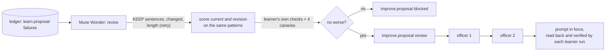

# Improver (`improve/`): the learner's prompt, revised by a model, tested by code, approved by people

(An extension of demo beat 6 in ARCHITECTURE, "The ledger learns": now the learner learns too. D95.)

Guarantees that the Policy Learner's instructions change only when a revision is no worse than the version in force on the ledger's own history, keeps every guard sentence, still lets every planted fault be caught, and has been approved by two different compliance officers. The improver proposes; it never activates anything, and nothing it can change reaches the checks, the approval counts or Gate.

Status: done for the back end (`/improve/v1` on `pl-gate`); the web pages are the next step. Live on Muse (2026-10-30): a Muse Wonder revision went to review with every canary caught; the demo shortcut was blocked by its canaries. · Last updated: 2026-10-30 · Tests: 17 unit in `tests/unit/test_improve.py` (16 run by default, 1 live), plus 6 improver import-boundary checks. Coverage: 100% for every file in `improve/`.

Related pages: [`learn.md`](learn.md) (the learner whose prompt this changes), [`claims.md`](claims.md) (the checks the canaries rely on), [`assist.md`](assist.md), [`../MODELS.md`](../MODELS.md), [`../DECISIONS.md`](../DECISIONS.md) D95.

## Responsibilities

| Part | File |
| --- | --- |
| The prompt in force, its guard sentences, reading an approved version back from the ledger | `learn/prompt.py` (the learner owns its prompt) |
| Muse Wonder's revision, the text checks, the demo shortcut | `improve/propose.py`, `assist/prompts/improve_prompt.md` |
| Planted faults (canaries) | `improve/canary.py` |
| Scoring a prompt on the history and comparing two | `improve/evaluate.py` |
| Runs, records, two-officer review, stale check | `improve/service.py` |
| `/improve/v1` routes | `improve/api.py` |

Does not own: the learner's checks, replay or patterns (`learn/`), the claim checker (`claims/`), signing and appending (Gate). It calls them.

Out of scope by design: any prompt but the learner's (`learn.prompt.TARGET`), the improver's own prompt, the canaries, the checks, the approval counts and Gate. The loop is one level deep.

## How it works

1. **Failures.** The learner's recent `rejected` or `blocked` proposals made under the prompt in force, with code's reasons; demo-planted faults are left out.
2. **Revision.** Muse Wonder gets the current instructions and those failures, and returns revised instructions, the changes and why. Code checks the text first (one retry): every `KEEP` sentence still there, something changed, at most 1.5 times as long.
3. **Scoring.** The prompt in force and the revision each draft a proposal for the same live patterns from the same proven log, concurrently. Each draft is judged by the learner's own `proposal_body` (counts against SQL, claims against records, policy checks, replay), then four faults are planted in it:

   | Canary | Planted | Caught by |
   | --- | --- | --- |
   | count | a restated count, plus 10 | count against SQL |
   | amount | a claimed payment amount, plus $1,000 | `claims.checker` |
   | approver | a claimed approver, renamed | `claims.checker` |
   | reason | a number no record states | `check_summary` |

   A fault that cannot be planted (no claim asserts an amount or an approver) counts as missed.
4. **Verdict by code.** `review` only if the revision accepts at least as many drafts, fails no more, and catches every canary the current prompt's drafts catch; otherwise `blocked`, with the reasons. Recorded as `improve.proposal`, signed by Gate.
5. **People.** Two different compliance officers approve (`improve.approve`). An approval is refused if the prompt in force changed since scoring (`improve.stale`).
6. **In force.** Every later learner run reads the latest fully approved version from the ledger, verifying the proposal and both approvals against Gate's key, the text against its hash, and the guard sentences. A version that fails any of these stops the learner (`learn.prompt`), the way a policy that fails its digest stops Gate. Nothing is held in memory.



## Interfaces

| Function / endpoint | Input | Output | Errors |
| --- | --- | --- | --- |
| `POST /improve/v1/run?inject_fault=` | officer token | 201 `{proposal}` | `improve.forbidden` 403, `improve.no_cases` 409, `improve.no_model` 503, `improve.model_failed` 502, `learn.no_active_policy` 409 |
| `GET /improve/v1/prompt` | officer token | the prompt in force: version, sha256, record id (null for the file), instructions | `learn.prompt` 500 |
| `GET /improve/v1/proposals/{id}` | officer token | the proposal and its approvals | `gate.record_not_found` 404 |
| `POST /improve/v1/proposals/{id}/approve` | officer token | 201 `{approval, in_force}` | `improve.not_reviewable`, `improve.already_approved`, `improve.stale` 409 |
| `ImproveService.run(officer, inject_fault=)` | | `Receipted` | as above |
| `prompt_in_force(records, gate, default)` | export records | `PromptInForce` | `LearnError learn.prompt` |
| `plant(drafted, pattern, log)` | | canary → `caught` / `missed` / `unplantable` / `not_applicable` | |
| `compare(base, candidate)` | two `Score`s | reasons the candidate is worse; empty if no worse | |

## Data

`improve.proposal` (Gate-signed): `target` (`learn_proposal`), `base` (version, sha256, record id, policy record id), `version` (`learn_proposal/4.<sha prefix>`), `instructions`, `prompt_sha256`, `changes`, `rationale`, `failures` (record ids, states, reasons), `window`, `scores.current` and `scores.candidate` (accepted, failed, latency, per case: outcome, reasons, claims, assertions, canaries), `state` (`review` / `blocked`), `reasons`, `approvals_needed` (2, from code), `model`, `prompt_version` (`improve_prompt/1`), `injected`.

`improve.approve` (Gate-signed): `proposal_record_id`, `approver`, `approval`, `approvals_needed`, `earlier`.

A learner proposal's `prompt_version` names the version that drafted it.

## Security and failure behaviour

| Threat or failure | Result | Test |
| --- | --- | --- |
| A revision that scores better by saying less | The amount and approver canaries cannot be planted, so the revision is blocked | `test_the_shortcut_scores_as_well_but_the_canaries_block_it`, live |
| A revision that drops the "decide nothing", "restate the counts" or injection guard sentence | Refused before scoring (retry), and again when recorded and when loaded | `test_a_revision_must_keep_...`, `test_a_prompt_that_does_not_verify_...` |
| A forged or altered approved prompt in the ledger | Hash, guard, state and two-distinct-approver checks stop the learner (`learn.prompt`) | `test_a_prompt_that_does_not_verify_stops_the_learner` |
| Approving against an old base | `improve.stale` | `test_a_revision_scored_against_a_replaced_prompt_is_stale` |
| One officer approving twice, or a supervisor | `improve.already_approved`, `improve.forbidden` | `test_a_revision_is_scored_...` |
| The model fails to revise, or a draft fails during scoring | No proposal (`improve.model_failed`); a failed draft counts against the prompt | `test_model_failures_are_counted_or_refused_never_guessed` |
| A model call anywhere else in `improve/` | Import test: only `propose.py` imports `assist.llm`; no ledger store or Gate internals | `test_the_improver_tests_prompts_without_a_model` |

What it does not protect against:

- **A revision that is worse in a way no canary measures**, for example less clear reasons that still pass every check. The two approvers see the changes and scores; that judgement is theirs.
- **Live variance.** Two cases per run, one draft each: a candidate can be blocked, or pass, by chance. The scores are recorded so approvers can see that.

## How to run and test

```bash
uv run pytest tests/unit/test_improve.py
MODEL_PROFILE=cloud uv run pytest tests/unit/test_improve.py -m live -s   # about 2 min, ~12 calls
# against make serve + make gate (a seeded week, an approved policy):
curl -X POST -H "Authorization: Bearer $(cat $KEYS_DIR/tokens/a.chen.token)" \
  http://127.0.0.1:8070/improve/v1/run
```

Live (2026-10-30, `medium` effort, the seeded week in memory): the honest run and the shortcut run together took 134 s. Muse Wonder's revision (`learn_proposal/4.8ab76d`, 12.9 s) reorganised the instructions into input, rule logic and output sections; current and revision both accepted 2 of 2, every canary caught, so `review`. The shortcut revision was followed by Muse Spark: amount and approver `unplantable` on both cases, so `blocked`. The slowest learner draft took 117 s, under the 150 s model timeout.

## Decisions

D95 (governed self-improvement), relying on D75 (restore from the ledger), D81 (stale base), D90 (live learner settings).

## Known gaps

- The web pages (a Console page to run it and read the scores; the inbox in the Approvals app) are the next step.
- One target prompt. The same loop could cover the auditor's prompts with their own canaries.
- No automatic revert when a version in force does worse live; a revert would be a new proposal, approved the same way.
- Two cases per run is a small sample; a larger window or repeated drafts would cost more calls.
