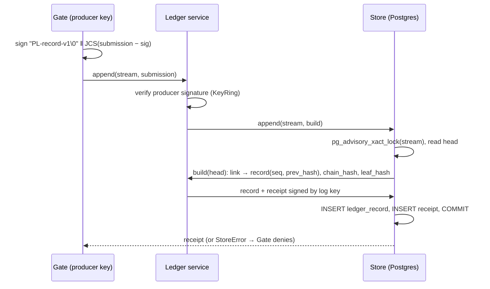

# Ledger

Guarantees that every accepted record is signed by its producer, chained to the record before it, and acknowledged with a receipt signed by the log key, so any later edit, deletion, insertion or reordering is caught at its sequence number.

Status: partial. Records, producer signatures, chain, receipts, memory and Postgres stores, and signed checkpoints are done ([`checkpoints.md`](checkpoints.md)). The export bundle ([`verify.md`](verify.md)) and HTTP API ([`api.md`](api.md)) are done. · Last updated: 2026-10-27 · Tests: 162 unit + property (99% coverage of `common/` and `ledger/` without `pg_store.py`), 7 integration (`pg_store.py` 95%). Checkpoint tests are counted in [`checkpoints.md`](checkpoints.md)

## Responsibilities

Owns:

- The v1 record format: exact field validation, record and receipt types, signing inputs (`format.py`); RFC 8785 canonical bytes, I-JSON rules, base64 and the chain hash (`canonical.py`, re-exported by `format.py`).
- Ed25519 keys, producer signatures and the key ring the ledger trusts (`signing.py`).
- The hash chain and verifying a stream (`chain.py`).
- Issuing and checking receipts, and detecting conflicting receipts (`receipts.py`).
- Storage: the `Store` interface, `MemoryStore`, and `PostgresStore` with insert-only triggers (`store.py`, `pg_store.py`, `schema.sql`).
- The `Ledger` service, which accepts a signed submission and returns a receipt or raises (`service.py`).

Does not own:

- Deciding anything. That is Gate's job; the ledger records decisions.
- Merkle hashing and proofs: the `merkle/` package (D25). Checkpoints live in `ledger/` but have their own page, [`checkpoints.md`](checkpoints.md).
- Witnesses and anchors (day 3).
- Key storage in production (KMS/HSM). Keys are loaded from files under `KEYS_DIR`.

## How it works

A producer (Gate) builds a **submission** (the record without `seq` and `prev_hash`) and signs it. The ledger checks the signature against the producer's registered key. Then, holding a per-stream lock, it reads the stream head, assigns the next `seq` and `prev_hash`, computes the chain and leaf hashes, stores the record, and signs a receipt. If any step fails, the caller gets an exception and no receipt, so Gate fails closed.

Verification walks a stream from `seq` 1. At each record it checks, in order: stream, `seq` = previous + 1, `prev_hash` = previous chain hash, `record_id` not seen before, producer signature. It stops at the first failure and reports its `seq` and reason.



## Interfaces

| Function / class | Input | Output | Errors |
| --- | --- | --- | --- |
| `format.canonical_bytes(value)` | JSON value | RFC 8785 bytes | `FormatError format.not_ijson` |
| `format.parse_json_strict(data)` | bytes | JSON value | `format.bad_json`, `format.duplicate_key`, `format.not_ijson` |
| `format.parse_canonical(data)` | bytes | JSON value | above, plus `format.not_canonical` |
| `format.Submission / Record / Receipt .from_json(obj)` | JSON object | frozen dataclass | `format.unknown_field`, `missing_field`, `bad_type`, `bad_value`, `bad_version`, `unsupported_alg`, `bad_base64`, `bad_time`, `too_large` |
| `format.chain_hash(prev, record_bytes)`, `leaf_hash(record_bytes)` | bytes | 32 bytes | `format.bad_hash` |
| `signing.Signer.from_pem_file / from_seed / generate` | path / 32-byte seed | `Signer` | `signature.bad_key`, `format.bad_key` |
| `signing.sign_submission(signer, producer_id=, stream=, record_id=, ts=, record_type=, body=)` | fields | `Submission` | `FormatError` |
| `signing.KeyRing([(owner, raw_pubkey)])` `.verify_submission(sub)`, `.verify(key_id, msg, sig, owner=)` | | `None` | `signature.unknown_key`, `producer_mismatch`, `invalid`, `key_conflict` |
| `chain.link(head, submission)` | `ChainHead`, `Submission` | `ChainedRecord` | `FormatError` |
| `chain.verify_chain(items, producers, stream=, start=, expected_head=)` | records, canonical lines, or stored JSON objects | `ChainReport(checked, head, first_break)` | none; failures are reported in the result |
| `receipts.issue_receipt(log_signer, item, received_at)` | | `Receipt` | |
| `receipts.verify_receipt(receipt, log_keys)` | | `None` | `SignatureError` |
| `receipts.check_receipts(history, receipts, log_keys)` | held receipts | lowest `ChainBreak` or `None` | |
| `receipts.conflicting_receipts(receipts)` | receipts | pairs that disagree on one `seq` | |
| `service.Ledger(store, producers, log_signer, clock)` `.append(stream, sub)` | | `Receipt` | `ledger.stream_mismatch`, `ledger.duplicate_record`, `SignatureError`, `StoreError` |
| `Ledger.append_json(stream, data)` | request bytes (≤ 64 KiB) | `Receipt` | as above, plus `FormatError` |
| `Ledger.get(record_id)` | | `(Record, Receipt)` | `ledger.not_found`, `StoreError` |
| `Ledger.verify_stream(stream)` | | `ChainReport` | `StoreError` |
| `PostgresStore.open(url, max_size=, timeout_seconds=)` | | store | |

`BreakReason` values: `malformed`, `wrong_stream`, `seq_mismatch`, `prev_hash_mismatch`, `duplicate_record_id`, `bad_producer_signature`, `truncated`, `head_mismatch`, `bad_receipt_signature`, `receipt_mismatch`, `missing_record`.

## Data

Record (stored, hashed):

| Field | Meaning |
| --- | --- |
| `v` | Format version, must be 1 |
| `stream` | e.g. `harbor-federal/decisions`; lowercase segments separated by `/`, ≤ 128 chars |
| `seq` | Gap-free position in the stream, from 1. Assigned by the ledger, not signed by the producer |
| `record_id` | ULID |
| `ts` | Producer time, `YYYY-MM-DDTHH:MM:SS.mmmZ` |
| `type` | Dotted name, e.g. `gate.decision` |
| `producer` | `{id, alg: "ed25519", key_id, sig}` |
| `body` | JSON object; integers only (±(2^53−1)), no floats |
| `prev_hash` | base64 chain hash of `seq − 1` (32 zero bytes for `seq` 1). Assigned by the ledger |

Receipt fields: `v, alg, stream, record_id, seq, leaf_hash, chain_hash, received_at, key_id, sig`.

Postgres tables (`ledger/schema.sql`): `ledger_record` has the record split into columns plus `chain_hash` and `leaf_hash`, with primary key `(stream, seq)` and unique `record_id`. `receipt` has the receipt fields, unique on `(stream, seq)`. Both tables have triggers that reject UPDATE, DELETE and TRUNCATE for every role. Role `pl_app` has only SELECT and INSERT.

## Security and failure behaviour

| Attack or failure | Result | Test |
| --- | --- | --- |
| Edit any field of a stored record | Producer signature fails, or `seq`/`prev_hash` mismatch, at that `seq` | `test_tamper.py`, `test_admin_edit_with_triggers_off_is_caught_at_its_seq` |
| Any single-byte change, deletion or insertion in an exported line | Fails at that line's `seq` (500 + 200 random cases per run) | `test_ledger_properties.py` |
| Delete, reorder, insert a forged record, replay a real one | `seq_mismatch`, `bad_producer_signature`, `duplicate_record_id` at the right `seq` | `test_tamper.py` |
| Truncate the tail | `truncated` against a trusted head, or `missing_record` against held receipts | `test_tamper.py` |
| Operator drops or reorders records and recomputes the chain | The chain verifies on its own (D9). Caught by receipts producers hold: `receipt_mismatch` at the first changed `seq` | `test_rechained_delete_passes_the_chain_but_fails_held_receipts` |
| Operator with the log key re-signs a rewritten history | Each receipt set verifies alone. Old and new receipts together form signed `conflicting_receipts` pairs | `test_rogue_resign_with_log_key_leaves_conflicting_receipts` |
| Bad or unknown producer signature on append | Rejected; nothing written | `test_service.py` |
| App role runs UPDATE or DELETE | `InsufficientPrivilege` | integration |
| Superuser runs UPDATE or DELETE | Trigger rejects it | integration |
| Database unreachable or write fails | `StoreError`; no receipt. Gate must deny | `test_store_down_means_no_receipt`, `test_unreachable_database_fails_closed` |

What it does not protect against yet:

- An operator who rewrites history while no producer kept its receipts. Signed checkpoints now make the rewrite visible to anyone holding an older checkpoint; witnesses (day 3) close it.
- A stolen producer key. Forged records would verify.
- Edits to the stored `chain_hash` column alone. Verification recomputes hashes and never reads that column, so the edit changes no verified data and is not reported at its row. The column is used only to find the head: the next append chains from the edited value and is reported as `prev_hash_mismatch` at that new `seq`.

## Formulas and formats

| Item | Definition |
| --- | --- |
| Canonical bytes | RFC 8785 (`rfc8785` 0.1.4), after I-JSON checks: no floats, NaN or ±Inf; no duplicate keys; integers within ±(2^53−1); valid Unicode |
| Producer signature | `Ed25519(gate_key, "PL-record-v1\x00" ‖ JCS(record − {seq, prev_hash, producer.sig}))` |
| Chain hash | `h_n = SHA-256("PL-chain-v1" ‖ h_(n−1) ‖ JCS(record_n))`, `h_0` = 32 zero bytes |
| Leaf hash | `SHA-256(0x00 ‖ JCS(record_n))` |
| Receipt signature | `Ed25519(log_key, "PL-receipt-v1\x00" ‖ JCS(receipt − {sig}))` |
| `key_id` | `"ed25519:" + hex(SHA-256(raw 32-byte public key))` |
| Encodings | Standard base64 with padding; must be the canonical spelling. Exported lines must equal their own canonical bytes |

Worked example: record 1 of `tests/vectors/ledger-v1.json`, signed with the TEST ONLY `gate-1` key.

```text
JCS(record_1) =
{"body":{"action":"value.transfer","agent":"payments-ops","decision":"escalate","policy_ids":["pay-new-payee-01"],"resource":{"amount":48000,"payee":"Northwind Supply","payee_new":true}},"prev_hash":"AAAAAAAAAAAAAAAAAAAAAAAAAAAAAAAAAAAAAAAAAAA=","producer":{"alg":"ed25519","id":"gate-1","key_id":"ed25519:b8c2f9a8d748ddb540905f42724e47da473ed84eba09105b5d8df0220be14b1e","sig":"mtN29hsXNGFZcQE3lTgeVwFye9r+JVLzT1tYcoJmgExcyf/CCjqeeRVEs545snxRrThSHkeO/tYAnPmpXVSVBw=="},"record_id":"01JB6X7Q2M9ZK3T8V4N5R6S7W0","seq":1,"stream":"harbor-federal/decisions","ts":"2026-10-29T21:14:03.112Z","type":"gate.decision","v":1}

leaf_hash  = /qWbj7gH5N/qnEYlEIKhy3G9fka4UplNYfkXijDf57k=
chain_hash = 9iwVeN0G1JqnLRF3wj/UE6PSqHRlnoHIxZXzVXPJSP4=   (h_1; record 2's prev_hash)

receipt =
{"alg":"ed25519","chain_hash":"9iwVeN0G1JqnLRF3wj/UE6PSqHRlnoHIxZXzVXPJSP4=","key_id":"ed25519:e4605ecd088946066f6fdd7a58d9bcb58485d668fc84a764f5f2703e88f32b99","leaf_hash":"/qWbj7gH5N/qnEYlEIKhy3G9fka4UplNYfkXijDf57k=","received_at":"2026-10-29T21:14:03.140Z","record_id":"01JB6X7Q2M9ZK3T8V4N5R6S7W0","seq":1,"sig":"wcfdb4sygI66UBcDGPrX9r5Wp43WtDTnXQSaF3HOc4MdeKbnRzdGmq3EwEFdKs9Y87RhlQzEKf9rqV6Om7TXBQ==","stream":"harbor-federal/decisions","v":1}
```

`test_vectors.py` re-checks every vector with `hashlib` and `cryptography` directly, not only through this module.

## How to run and test

```sh
uv sync
make check              # ruff, mypy --strict, unit + property tests with coverage ≥ 90%, gitleaks
cp .env.example .env    # then set passwords
make test-integration   # starts Postgres 16, re-applies schema.sql, runs all 14 integration tests
make vectors            # regenerates tests/vectors/ledger-v1.json; a diff means the format changed
```

Environment variables: `DATABASE_URL` (app role), `ADMIN_DATABASE_URL` (superuser; integration tests and the demo tamper button only), `KEYS_DIR`, `LEDGER_STREAM`, `LEDGER_ORIGIN`, `CHECKPOINT_DIR`, `DEMO_MODE`, plus `POSTGRES_PASSWORD` and `PL_APP_PASSWORD` for compose.

## Decisions

D3, D9–D24 in [`docs/DECISIONS.md`](../DECISIONS.md).

## Known gaps

- Range exports. Whole-stream export (`ledger/export.py`, `pl-export`) is done and documented with its verifier in [`verify.md`](verify.md).
- The ledger core logs nothing itself; the API and checkpoint loop log JSON lines with `trace_id` ([`api.md`](api.md)).
- Key rotation records are not implemented.
- Strings containing U+0000 are valid I-JSON, but Postgres `jsonb` rejects them, so such an append fails with `StoreError` (fail closed).
- The import-boundary test lets the verifier side import `common.errors`, `common.clock` and `common.ids`, because `ledger.format` depends on them. The skill lists only `ledger.format` and the Merkle core.
