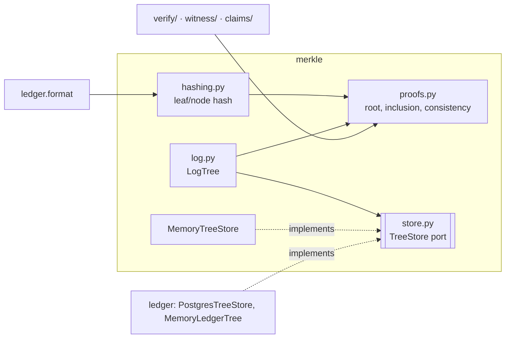

# Merkle

Guarantees RFC 9162 Merkle tree hashing, inclusion proofs and consistency proofs over any sequence of leaf hashes, with verification that returns `False` for every malformed or tampered input.

Status: done for now (pure core, port, in-memory adapter). The ledger adapters and signed checkpoints are built on it; see [`checkpoints.md`](checkpoints.md). · Last updated: 2026-10-27 · Tests: 38 (unit + property) plus 4 import-boundary checks, coverage 100% lines and branches

## Responsibilities

Owns:

- Leaf and node hashing with domain separation (`hashing.py`).
- Roots, inclusion proofs and consistency proofs: generation and verification (`proofs.py`).
- The `TreeStore` port, which adapters implement, and `MemoryTreeStore` (`store.py`).
- `LogTree`: tree heads and proofs at any size, computed through a port (`log.py`).

Does not own:

- Ledger records. Callers hand it 32-byte leaf hashes. For the ledger, leaf `i` is the `leaf_hash` of the record with `seq = i + 1` (D16).
- Writing leaves. The port is read-only; whoever owns the data appends it.
- Signed checkpoints (`ledger/checkpoint.py`, [`checkpoints.md`](checkpoints.md)) and cosignatures ([`witness.md`](witness.md)).
- Storage adapters for real systems. Each lives with the system it reads: the Postgres adapter is `ledger.pg_tree.PostgresTreeStore`, because it reads `ledger_record.leaf_hash`.

## How it works

The core is pure: stdlib `hashlib`/`hmac` plus `common.errors`. Generation follows the recursive definitions in RFC 9162 §2.1 (MTH, PATH, SUBPROOF). Verification follows the iterative algorithms in §2.1.3.2 and §2.1.4.2. The verifier, the witnesses and the claim checker import only this core.

`LogTree` sits on top. It asks a `TreeStore` adapter for leaf hashes, checks it got exactly as many as it asked for, and runs the core. Swapping storage, for example to a tile store such as C2SP tlog-tiles, means writing a new adapter; nothing that verifies changes.



## Interfaces

| Function / class | Input | Output | Errors |
| --- | --- | --- | --- |
| `hashing.leaf_hash(data)` | bytes | 32 bytes | |
| `hashing.node_hash(left, right)` | two 32-byte hashes | 32 bytes | `MerkleError merkle.bad_hash` |
| `proofs.root_hash(leaves)` | leaf hashes | root (`EMPTY_ROOT` for none) | `merkle.bad_hash` |
| `proofs.inclusion_proof(index, leaves)` | index, leaf hashes | list of hashes | `merkle.bad_index`, `merkle.bad_hash` |
| `proofs.consistency_proof(old_size, leaves)` | old size, leaf hashes of the new tree | list of hashes | `merkle.bad_size`, `merkle.bad_hash` |
| `proofs.verify_inclusion(leaf, index, size, proof, root)` | | `bool` | never raises on bad input |
| `proofs.verify_consistency(old_size, new_size, old_root, new_root, proof)` | | `bool` | never raises on bad input |
| `TreeStore.size()`, `.leaf_hashes(start, end)` | | int, list of hashes | adapter-specific |
| `MemoryTreeStore.append(leaf)` | 32-byte hash | | `merkle.bad_hash` |
| `LogTree(store).head(size=None)` | | `TreeHead(size, root)` | `merkle.bad_size`, `merkle.bad_store` |
| `LogTree.prove_inclusion(index, size)` | | `InclusionProof(index, size, hashes)` | above, plus `merkle.bad_index` |
| `LogTree.prove_consistency(old_size, new_size)` | | `ConsistencyProof(old_size, new_size, hashes)` | above |

## Data

No tables or files. Inputs and outputs are raw 32-byte SHA-256 hashes; encoding them (base64 in the ledger) is the caller's job.

## Security and failure behaviour

| Threat or failure | Behaviour | Test |
| --- | --- | --- |
| A leaf, proof element, root, index or size is wrong | `verify_*` returns `False` | `test_inclusion_rejects_wrong_inputs`, `test_consistency_rejects_wrong_inputs` |
| One bit flipped in any proof element or root (random trees of 1–70 leaves) | Verification fails | `test_merkle_properties.py` (300 examples each) |
| History rewritten (one leaf changed inside the old tree) and the tree grown | The proof from the rewritten tree does not verify against the old root | `test_rewritten_history_has_no_consistency_proof` |
| Leaf passed off as a node, or the reverse | Impossible by construction: `0x00` and `0x01` prefixes | `test_hashing_formulas` |
| Adapter returns too few or too many leaves | `MerkleError merkle.bad_store`; no head or proof is produced | `test_adapter_returning_wrong_count_fails_closed` |
| Malformed input reaching verification | `False`, never an exception, so an error path cannot skip a check | negative tests above |

What it does not protect against on its own: a tree head nobody signed or witnessed. Consistency proofs only help when someone kept an earlier root. That is what signed checkpoints ([`checkpoints.md`](checkpoints.md)) and witnesses ([`witness.md`](witness.md)) are for.

## Formulas and formats

| Item | Definition (RFC 9162 §2.1) |
| --- | --- |
| Empty root | `SHA-256("")` = `e3b0c442…b855` |
| Leaf | `SHA-256(0x00 ‖ data)`; for the ledger, `data` = `JCS(record)` |
| Node | `SHA-256(0x01 ‖ left ‖ right)` |
| MTH(n) | Split at k, the largest power of two `< n`: `node(MTH(D[0:k]), MTH(D[k:n]))` |
| Inclusion proof | `PATH(m, D[n])` |
| Consistency proof | `SUBPROOF(m, D[n], true)`; empty for `m = 0` or `m = n` |

Worked example from `tests/vectors/merkle-rfc9162.json`, using the 8 leaf inputs published by transparency-dev/merkle:

```text
leaf 0 input ""      → leaf hash 6e340b9cffb37a989ca544e6bb780a2c78901d3fb33738768511a30617afa01d
root of 8 leaves     → 5dc9da79a70659a9ad559cb701ded9a2ab9d823aad2f4960cfe370eff4604328
inclusion(5, 8)      → L0[4] bc1a0643…, L1[3] ca854ea1…, L2[0] d37ee418…
consistency(6 → 8)   → L1[2] 0ebc5d34…, L1[3] ca854ea1…, L2[0] d37ee418…
```

All 9 roots (sizes 0–8), 6 inclusion proofs and 5 consistency proofs match the vectors and verify.

## How to run and test

```sh
uv run pytest tests/unit/test_merkle_proofs.py tests/unit/test_merkle_log.py tests/property/test_merkle_properties.py
make check
```

No environment variables.

## Decisions

D16 (leaf index = seq − 1), D25 (separate package with a port), D26 (vector source) in [`docs/DECISIONS.md`](../DECISIONS.md).

## Known gaps

- `LogTree` reads every leaf up to `size` on each call, which is O(n). That's fine at demo scale. An adapter that caches complete subtrees can replace it later behind the same interface.
- The published vectors include no proofs, so the expected proofs were derived by hand from the published node hashes. Each one lists its node coordinates so it can be checked.
