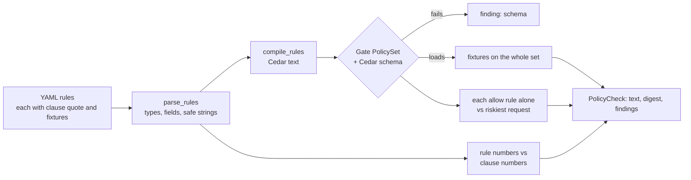

# Policy (`policy/`): policy text to checked Cedar rules

Guarantees that a rule drafted from a policy document reaches a reviewer only as plain YAML citing its clause, compiled to Cedar by code, and already checked: it passes the Cedar schema, its fixtures get the outcomes they expect from the whole rule set, it does not allow the riskiest request on its own, and every number in it is a number its clause states.

Status: partial: rules, compiler and checks (step 1 of 3). Not yet: PDF text with page and character spans, Muse Wonder drafting (step 2), review, approval records and activation in Gate (step 3). · Last updated: 2026-10-28 · Tests: 40 unit (`tests/unit/test_policy.py`). Coverage: `policy/rules.py` 99%, `policy/compiler.py` 100%, `policy/checks.py` 100%.

Related pages: [`gate.md`](gate.md) (how Gate evaluates the compiled set), [`../DECISIONS.md`](../DECISIONS.md) D68–D70.

## Responsibilities

Owns:

| Part | File |
| --- | --- |
| Rule format: fields per action, parsing and validation, fixture contexts, numbers in clause text | `policy/rules.py` |
| YAML rules to Cedar text | `policy/compiler.py` |
| Checks before review: schema, fixtures, untested or one-sided rules, allows everything, clause numbers | `policy/checks.py` |
| The seed rules, in YAML, quoting the demo policy | `deploy/policies/harbor-federal.yaml` |
| The demo policy text (fictional Harbor Federal, policy PO-7) | `deploy/demo/payments_policy.txt` |

Does not own:

- **Deciding.** Gate evaluates the compiled Cedar (`gate.decide.PolicySet`); this module reuses it to run fixtures, so a fixture passes only if Gate would decide the same.
- **Drafting.** Muse Wonder will draft rules in step 2; nothing here calls a model (R2).
- **Fixing.** Checks report findings to the reviewer; nothing is corrected automatically.

## How it works

1. `parse_rules` reads YAML with `yaml.safe_load` and validates every rule: known action, known fields for that action, operators that fit the field's type, values of the field's type. Dollar amounts are whole numbers or `"5000.10"` strings; floats are refused. Strings may contain only `A-Z a-z 0-9 . _ -`, so no value can leave a Cedar string literal.
2. `compile_rules` writes one Cedar policy per rule, in order, with Gate's annotations (D49): `allow` is a `permit`, `escalate` is a `permit` with `@escalate` and `@approver_role`, `deny` is a `forbid`. `amount` in dollars becomes `context.amount_cents` in cents (D50).
3. `check_rules` loads the compiled text with Gate's own `PolicySet` (schema included) and runs every check. The result carries the Cedar text, Gate's `policy_set` digest for it, and the findings.



### The checks

| Check | Flags | Why |
| --- | --- | --- |
| `schema` | The set does not load: Cedar syntax, schema, or Gate's own rules (unique `@id`, annotations) | Gate would refuse it anyway |
| `fixture` | `fixture 1: expected allow, got escalate (pay-over-5k-01)` | Fixtures run against the whole set, because outcomes come from all rules together |
| `untested` | No fixture triggers the rule | The rule's conditions were never exercised |
| `one_sided` | Every fixture triggers it | Nothing shows where the rule stops |
| `allows_everything` | An `allow` rule that, on its own, allows the riskiest request for its action: for a payment $1,000,000,000 in `XXX` to a new payee at 03:00 on a Sunday | A rule that constrains nothing that matters |
| `clause_number` | `amount gt 50000 is not a number clause 3.2 states (it states: 5000)` | The planted bad rule in beat 1: the drafter's own fixtures agree with its wrong threshold, so only the clause can catch it |

Clause numbers (`clause_numbers`): amounts and counts as written (`$5,000` is 5000), times as hours (`5:00 p.m.` is 17, `18:00` is 18, `noon` is 12), and weekday names as ISO numbers (Monday 1 … Sunday 7, matching Gate's `local_weekday`). The value 0 is exempt: it encodes "none" or "any" (`external_recipients: 0`).

## Interfaces

| Function / type | Input | Output | Errors |
| --- | --- | --- | --- |
| `parse_rules(text)` | YAML, at most 256 KiB | `tuple[PolicyRule, ...]` | `PolicyError`: `policy.yaml`, `policy.empty`, `policy.rule_shape`, `policy.rule_action`, `policy.rule_field`, `policy.rule_op`, `policy.rule_value`, `policy.duplicate_id` |
| `compile_rule(rule)`, `compile_rules(rules)` | parsed rules | Cedar text | |
| `check_rules(rules, *, schema=None)` | parsed rules; Gate's schema by default | `PolicyCheck(text, digest, findings)`, `.ok` | |
| `to_context(action, facts)` | policy-unit facts | full Cedar context, defaults filled | `PolicyError` |
| `clause_numbers(text)` | clause text | set of `Decimal` | |
| `FIELDS` | | action → field → `FieldSpec(cedar, kind)` | |

## Data

Rule format (`deploy/policies/harbor-federal.yaml`):

```yaml
- id: pay-over-5k-01
  source: { doc: payments_policy.pdf, page: 1, clause: "3.2",
            quote: "Any payment over $5,000 requires approval by a payments supervisor before it is sent." }
  agent: payments-ops            # optional; absent means any agent
  when: { action: value.transfer, amount: { gt: 5000 } }
  unless: { local_hour: { gte: 9, lt: 17 } }   # optional
  then: escalate                 # allow | escalate | deny
  approver_role: payments-supervisor          # exactly when then is escalate
  tests:
    - { amount: 48000, payee_new: false, expect: escalate }
    - { amount: 4999, payee_new: false, expect: allow }
```

Compiles to:

```cedar
// payments_policy.pdf p.1 clause 3.2
@id("pay-over-5k-01")
@escalate
@approver_role("payments-supervisor")
permit (principal == Agent::"payments-ops", action == Action::"value.transfer", resource)
when { context.amount_cents > 500000 };
```

| Action | Fields (kind) |
| --- | --- |
| `value.transfer` | `amount` (dollars → `amount_cents`), `currency`, `payee_id` (string), `payee_new` (bool), `local_hour`, `local_weekday` (int) |
| `comm.external` | `recipients`, `external_recipients`, `local_hour`, `local_weekday` (int) |
| `data.read` | `data_class` (string), `local_hour`, `local_weekday` (int) |

A condition is `field: value` (equals) or `field: { op: value, ... }` with `eq ne gt gte lt lte`; ordered operators only on dollars and ints. A fixture lists the fields it sets (the rest take defaults: $100, USD, a known payee, Tuesday 10:00), `expect`, and optionally `agent` (default: the rule's agent).

## Security and failure behaviour

| Attack or failure | Result | Test |
| --- | --- | --- |
| A string that would close the Cedar literal (`"a\" \|\| true \|\| \""`), or an agent name that injects a policy | Refused at parse (`policy.rule_value`) | `test_malformed_or_unsafe_rules_are_refused` |
| Float amount (5000.5), three decimals, `payee_new: 1`, `gt` on a bool | Refused | same |
| Unknown field, action, operator or rule key | Refused | same |
| Escalate without an approver role, or a role on allow or deny | Refused | same |
| Repeated rule id | Refused (Cedar itself would accept it) | same |
| YAML tags for Python objects | `safe_load` builds plain data only | |
| Threshold not in the clause ($50,000 from a $5,000 clause) | `clause_number` finding | `test_a_threshold_the_clause_does_not_state_is_flagged` |
| An allow rule with no real condition | `allows_everything` finding | `test_a_rule_that_allows_everything_is_flagged` |
| A fixture the set does not satisfy | `fixture` finding, with the actual outcome and matched rules | `test_a_failing_fixture_is_flagged_with_what_happened` |
| Fixtures that never, or always, trigger the rule | `untested`, `one_sided` | `test_a_rule_its_fixtures_never_trigger_is_flagged` |
| Compiled set fails the schema | `schema` finding; no digest; `ok` is false | `test_a_set_that_fails_the_schema_is_flagged` |
| Compiler drifts from the hand-written policy | Every probe decided the same by both, for two agents | `test_compiled_seed_decides_like_the_hand_written_cedar` |

What it does not protect against:

- **A wrong rule whose numbers are right.** `gt` where the clause means "$5,000 or more", or the wrong field, passes the clause check. Fixtures and the reviewer are the defence.
- **Wrong meaning with the right shape.** A rule that escalates where the clause forbids is not detected by code; the reviewer sees the rule beside its quoted clause.
- **The quote itself.** Step 1 trusts the rule's `quote`; step 2 checks it is in the extracted document and records its page and character span.

## Formulas and formats

No hashing of its own. The `policy_set` digest of a compiled set is Gate's: `"sha256:" ‖ hex(SHA-256(UTF-8 Cedar text))` (`gate.decide.PolicySet.digest`). Compilation is deterministic, so the same YAML always gives the same digest.

## How to run and test

```sh
uv run pytest tests/unit/test_policy.py
uv run python -c "from pathlib import Path; from policy.rules import parse_rules; from policy.checks import check_rules; r = check_rules(parse_rules(Path('deploy/policies/harbor-federal.yaml').read_text())); print(r.ok, r.digest)"
```

## Decisions

[D68](../DECISIONS.md) the rule format · [D69](../DECISIONS.md) the checks · [D70](../DECISIONS.md) PyYAML · plus D49 (Gate's Cedar conventions), D50 (integer cents).

## Known gaps

- Steps 2 and 3: PDF spans, Muse Wonder drafting, the quote-in-document check, review state, approval records, activation in Gate, the `/policy/v1/drafts` API and `make demo-policy`.
- Gate still loads the hand-written `harbor-federal.cedar`; the compiled seed decides identically (tested), and step 3 switches Gate to approved compiled sets.
- `gt` versus `gte` wording ("over" versus "or more") is not checked.
- No `or` across conditions within one rule; two rules express it. `unless` covers "outside business hours".
