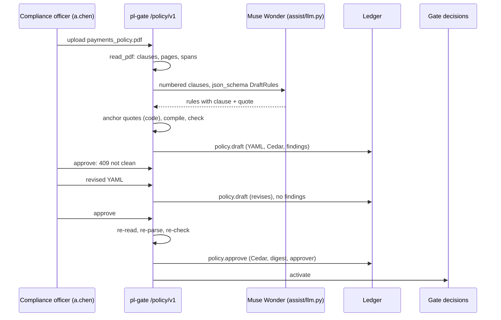
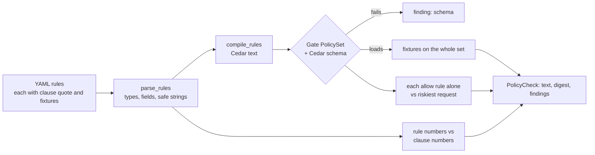

# Policy (`policy/`): policy PDF to approved, enforced Cedar rules

Guarantees that a rule reaches Gate only after a compliance officer approved it, and that it was checked first. A rule drafted from a policy PDF reaches the reviewer as plain YAML citing its clause, with the page and character span computed by code. Code compiles it to Cedar and checks that it passes the Cedar schema, that its fixtures get the outcomes they expect from the whole rule set, that it does not allow the riskiest request on its own, and that every number in it is a number its clause states. Approval re-runs every check and refuses any draft with findings. Every draft and approval is a signed ledger record, and Gate restores the latest approval when it restarts.

Status: done for this step (demo beat 1, `make demo-policy`). Muse Wonder (`muse-wonder-1.0`) drafted the demo policy live on 2026-10-29 in 28 s, every quote found in its clause and no check findings. · Last updated: 2026-10-29 · Tests: 62 unit (`test_policy.py` 42, `test_policy_review.py` 19 run by default, 1 live). A rule whose `action` is not a string is refused as `policy.rule_action` (found live, D90). Coverage: `rules.py` 97%, `compiler.py` 100%, `checks.py` 100%, `pdf.py` 98%, `draft.py` 97%, `service.py` 98%, `api.py` 100%.

Related pages: [`gate.md`](gate.md) (how Gate evaluates and activates the set), [`assist.md`](assist.md) (the model entry point and the mock), [`../MODELS.md`](../MODELS.md), [`../DECISIONS.md`](../DECISIONS.md) D68–D75.

## Responsibilities

Owns:

| Part | File |
| --- | --- |
| Rule format: fields per action, parsing and validation, fixture contexts, numbers in clause text | `policy/rules.py` |
| YAML rules to Cedar text | `policy/compiler.py` |
| Checks before review: schema, fixtures, untested or one-sided rules, allows everything, clause numbers | `policy/checks.py` |
| PDF to text, numbered clauses, pages and character spans; hostile-input limits | `policy/pdf.py` |
| Muse Wonder drafting: `DraftRules` schema, anchoring each rule to its clause, the demo fault | `policy/draft.py`, `assist/prompts/policy_draft.md` |
| Review: `policy.draft` and `policy.approve` records, re-check on approval, activation, restore at startup | `policy/service.py` |
| HTTP API (`/policy/v1`), served by `pl-gate` | `policy/api.py` |
| The demo PDF and the script that builds it; the beat 1 demo | `deploy/demo/payments_policy.pdf`, `scripts/make_policy_pdf.py`, `scripts/demo_policy.py` |
| The seed rules, in YAML, quoting the demo policy | `deploy/policies/harbor-federal.yaml` |
| The demo policy text (fictional Harbor Federal, policy PO-7) | `deploy/demo/payments_policy.txt` |

Does not own:

- **Deciding.** Gate evaluates the compiled Cedar (`gate.decide.PolicySet`); this module reuses it to run fixtures, so a fixture passes only if Gate would decide the same.
- **Model calls.** Drafting goes through `assist/llm.py` (role `wonder`). Rules, compiler, checks, PDF reading and approval call no model (R2).
- **Fixing.** Checks report findings to the reviewer; nothing is corrected automatically.
- **Signing.** Gate signs the policy records with `gate-1`, as it signs verdicts; the officer's token gives the authority.

## How it works

### Beat 1 end to end

1. A compliance officer uploads the PDF: `POST /policy/v1/drafts?name=payments_policy.pdf`. `read_pdf` refuses anything over 5 MiB or 200 pages, encrypted files, and anything pypdf cannot parse. It finds the numbered clauses (`3.2 Any payment over $5,000…`) with their page and span.
2. Muse Wonder gets the clauses and returns `DraftRules`: per rule, the clause number and a quote, conditions, outcome and fixtures. Code finds the quote inside that clause and sets the document, page and span itself. A quote that is not there, or a rule that fails parsing, gets one retry with the problems; a second failure means no draft.
3. Code compiles and checks the rules (below). The draft is appended as `policy.draft` with the YAML, Cedar, digest and every finding.
4. The officer reads each rule beside its clause. Approving a draft with findings is refused (`409 policy.not_clean`). The officer edits the YAML: `POST /policy/v1/drafts/{id}/revisions` appends a new `policy.draft` that `revises` the old one, checked again.
5. `POST /policy/v1/drafts/{id}/approve` re-reads the draft from the ledger, re-parses and re-checks it, and refuses unless there are no findings. It appends `policy.approve` with the exact Cedar text and digest, and Gate decides with that set from then on. Decision records cite the new `policy_set`.
6. When `pl-gate` restarts, `restore_active` reads the stream's latest `policy.approve` back through the ledger API (signature and receipt verified) and activates it if its Cedar matches its digest. Otherwise Gate starts with `GATE_POLICY_FILE`.



### Rules, compiler and checks

1. `parse_rules` reads YAML with `yaml.safe_load` and validates every rule: known action, known fields for that action, operators that fit the field's type, values of the field's type. Dollar amounts are whole numbers or `"5000.10"` strings; floats are refused. Strings may contain only `A-Z a-z 0-9 . _ -`, so no value can leave a Cedar string literal.
2. `compile_rules` writes one Cedar policy per rule, in order, with Gate's annotations (D49): `allow` is a `permit`, `escalate` is a `permit` with `@escalate` and `@approver_role`, `deny` is a `forbid`. `amount` in dollars becomes `context.amount_cents` in cents (D50).
3. `check_rules` loads the compiled text with Gate's own `PolicySet` (schema included) and runs every check. The result carries the Cedar text, Gate's `policy_set` digest for it, and the findings.



### The checks

| Check | Flags | Why |
| --- | --- | --- |
| `schema` | The set does not load: Cedar syntax, schema, or Gate's own rules (unique `@id`, annotations) | Gate would refuse it anyway |
| `fixture` | `fixture 1: expected allow, got escalate (pay-over-5k-01)` | Fixtures run against the whole set, because outcomes come from all rules together |
| `untested` | No fixture triggers the rule | The rule's conditions were never exercised |
| `one_sided` | Every fixture triggers it | Nothing shows where the rule stops |
| `allows_everything` | An `allow` rule that, on its own, allows the riskiest request for its action: for a payment $1,000,000,000 in `XXX` to a new payee at 03:00 on a Sunday | A rule that constrains nothing that matters |
| `clause_number` | `amount gt 50000 is not a number clause 3.2 states (it states: 5000)` | The planted bad rule in beat 1: the drafter's own fixtures agree with its wrong threshold, so only the clause can catch it |

Clause numbers (`clause_numbers`): amounts and counts as written (`$5,000` is 5000), times as hours (`5:00 p.m.` is 17, `18:00` is 18, `noon` is 12), and weekday names as ISO numbers (Monday 1 … Sunday 7, matching Gate's `local_weekday`). The value 0 is exempt: it encodes "none" or "any" (`external_recipients: 0`).

## Interfaces

| Function / type | Input | Output | Errors |
| --- | --- | --- | --- |
| `parse_rules(text)` | YAML, at most 256 KiB | `tuple[PolicyRule, ...]` | `PolicyError`: `policy.yaml`, `policy.empty`, `policy.rule_shape`, `policy.rule_action`, `policy.rule_field`, `policy.rule_op`, `policy.rule_value`, `policy.duplicate_id` |
| `compile_rule(rule)`, `compile_rules(rules)` | parsed rules | Cedar text | |
| `check_rules(rules, *, schema=None)` | parsed rules; Gate's schema by default | `PolicyCheck(text, digest, findings)`, `.ok` | |
| `to_context(action, facts)` | policy-unit facts | full Cedar context, defaults filled | `PolicyError` |
| `clause_numbers(text)` | clause text | set of `Decimal` | |
| `FIELDS` | | action → field → `FieldSpec(cedar, kind)` | |
| `rules_from_data(raw)`, `rule_data(rule)`, `to_yaml(rules)` | parsed data; rules | rules; plain data; YAML that parses back to equal rules | as `parse_rules` |
| `read_pdf(data, name)` | PDF bytes | `Document(name, sha256, pages, text, clauses)`, `.clause(id)`, `.locate(id, quote)` | `policy.pdf_unreadable`, `pdf_too_large`, `pdf_encrypted`, `pdf_no_clauses`, `pdf_duplicate_clause` |
| `Drafter(llm).draft(document, inject_fault=False)` | | `Draft(document, rules, report, model, prompt_version, injected)` | `ModelOutputError` |
| `PolicyService(gate, drafter)`: `.submit(pdf, name, officer, inject_fault=)`, `.revise(draft_id, yaml, officer)`, `.approve(draft_id, officer)` | | receipted `policy.draft` / `policy.approve` | `policy.forbidden`, `policy.no_drafter`, `policy.not_clean`, `policy.stale_base`, Gate's ledger errors |
| `restore_active(gate, history)` | | the restored record id or None | `policy.digest`, Gate's read errors |
| `active_draft(gate)` | | the active `policy.approve` and the `policy.draft` it approved, verified, or None | Gate's read errors |
| `draft_body(yaml, report, doc, **about)` | | a `policy.draft` body (used by the learner, D81) | |

HTTP (every route needs an approver token with the `compliance-officer` role; responses are `{record, receipt}`):

| Method | Path | Body | Success | Errors |
| --- | --- | --- | --- | --- |
| POST | `/policy/v1/drafts?name=&inject_fault=` | PDF bytes (≤ 5 MiB) | 201 `policy.draft` | 400 `policy.pdf_*`, 403 (role; `inject_fault` without `DEMO_MODE=true`), 413, 503 `policy.no_drafter` |
| GET | `/policy/v1/drafts/{id}` | | 200 | 404 |
| POST | `/policy/v1/drafts/{id}/revisions` | YAML (≤ 256 KiB) | 201 `policy.draft` | 400 `policy.yaml`, `policy.rule_*` |
| POST | `/policy/v1/drafts/{id}/approve` | | 201 `policy.approve` | 409 `policy.not_clean`, `policy.stale_base` (a learner draft built on a set that is no longer active, D81) |
| GET | `/policy/v1/active` | | `{policy_set, rules, policy_record}` | |

`GET /gate/v1/health` also reports `policy_record` (None while Gate runs on its policy file).

## Data

Rule format (`deploy/policies/harbor-federal.yaml`):

```yaml
- id: pay-over-5k-01
  source: { doc: payments_policy.pdf, page: 1, clause: "3.2",
            quote: "Any payment over $5,000 requires approval by a payments supervisor before it is sent." }
  agent: payments-ops            # optional; absent means any agent
  when: { action: value.transfer, amount: { gt: 5000 } }
  unless: { local_hour: { gte: 9, lt: 17 } }   # optional
  then: escalate                 # allow | escalate | deny
  approver_role: payments-supervisor          # exactly when then is escalate
  tests:
    - { amount: 48000, payee_new: false, expect: escalate }
    - { amount: 4999, payee_new: false, expect: allow }
```

Compiles to:

```cedar
// payments_policy.pdf p.1 clause 3.2
@id("pay-over-5k-01")
@escalate
@approver_role("payments-supervisor")
permit (principal == Agent::"payments-ops", action == Action::"value.transfer", resource)
when { context.amount_cents > 500000 };
```

| Action | Fields (kind) |
| --- | --- |
| `value.transfer` | `amount` (dollars → `amount_cents`), `currency`, `payee_id` (string), `payee_new` (bool), `local_hour`, `local_weekday` (int) |
| `comm.external` | `recipients`, `external_recipients`, `local_hour`, `local_weekday` (int) |
| `data.read` | `data_class` (string), `local_hour`, `local_weekday` (int) |

A condition is `field: value` (equals) or `field: { op: value, ... }` with `eq ne gt gte lt lte`; ordered operators only on dollars and ints. A fixture lists the fields it sets (the rest take defaults: $100, USD, a known payee, Tuesday 10:00), `expect`, and optionally `agent` (default: the rule's agent).

`policy.draft` (signed by `gate-1`): `doc{name, sha256, pages}`, `rules_yaml`, `rules_sha256`, `cedar`, `policy_set` (digest, or null if the set does not load), `findings[{rule_id, check, detail}]`, `model` and `prompt_version` (null for an officer's revision), `injected` (the rule the demo fault changed), `revises`, `author`.

`policy.approve` (signed by `gate-1`): `draft_record_id`, `approver`, `doc`, `rules` (ids), `rules_sha256`, `cedar` (the exact text Gate now evaluates), `policy_set`.

No new tables: the ledger holds every draft and approval, and the latest approval is what Gate enforces.

## Security and failure behaviour

| Attack or failure | Result | Test |
| --- | --- | --- |
| A string that would close the Cedar literal (`"a\" \|\| true \|\| \""`), or an agent name that injects a policy | Refused at parse (`policy.rule_value`) | `test_malformed_or_unsafe_rules_are_refused` |
| Float amount (5000.5), three decimals, `payee_new: 1`, `gt` on a bool | Refused | same |
| Unknown field, action, operator or rule key | Refused | same |
| Escalate without an approver role, or a role on allow or deny | Refused | same |
| Repeated rule id | Refused (Cedar itself would accept it) | same |
| YAML tags for Python objects | `safe_load` builds plain data only | |
| Threshold not in the clause ($50,000 from a $5,000 clause) | `clause_number` finding | `test_a_threshold_the_clause_does_not_state_is_flagged` |
| An allow rule with no real condition | `allows_everything` finding | `test_a_rule_that_allows_everything_is_flagged` |
| A fixture the set does not satisfy | `fixture` finding, with the actual outcome and matched rules | `test_a_failing_fixture_is_flagged_with_what_happened` |
| Fixtures that never, or always, trigger the rule | `untested`, `one_sided` | `test_a_rule_its_fixtures_never_trigger_is_flagged` |
| Compiled set fails the schema | `schema` finding; no digest; `ok` is false | `test_a_set_that_fails_the_schema_is_flagged` |
| Compiler drifts from the hand-written policy | Every probe decided the same by both, for two agents | `test_compiled_seed_decides_like_the_hand_written_cedar` |
| Malformed, truncated, oversized or encrypted PDF; no clauses; a clause number twice | Refused, no draft | `test_a_hostile_or_unusable_pdf_is_refused`, `test_an_encrypted_pdf_is_refused` |
| Drafter quotes text that is not in the cited clause | One retry, then no draft | `test_a_quote_that_is_not_in_its_clause_gets_one_retry` |
| Drafter gives a page or span | Not possible: the schema has neither; code sets them | `test_the_draft_cites_clauses_with_spans_computed_by_code` |
| Planted wrong threshold ($50,000 from a $5,000 clause) | `clause_number` finding; approval refused until fixed | `test_the_planted_bad_rule_is_caught_by_its_clause`, `test_beat_1_caught_fixed_approved_and_enforced` |
| Approving with findings, or a stored finding list that was emptied | Approval re-parses and re-checks the YAML from the ledger | `test_approval_rechecks_and_never_trusts_stored_findings` |
| Approving a record that is not a draft | Refused (record type checked) | same |
| A supervisor or agent token drafts, revises or approves | 403 `policy.forbidden` / auth error | `test_only_a_compliance_officer_drafts_revises_or_approves`, `test_the_api_refuses_what_it_should` |
| `inject_fault` outside demo mode | 403 | `test_the_api_refuses_what_it_should` |
| Gate restarts | Latest approval restored from the ledger, verified | `test_gate_restores_the_latest_approval_at_startup` |
| Prompt injection inside the PDF | The drafter has no tools; its output is only a draft, checked and approved by a person | ARCHITECTURE threat model |

What it does not protect against:

- **A wrong rule whose numbers are right.** `gt` where the clause means "$5,000 or more", or the wrong field, passes the clause check. Fixtures and the reviewer are the defence.
- **Wrong meaning with the right shape.** A rule that escalates where the clause forbids is not detected by code; the reviewer sees the rule beside its quoted clause.
- **A wrong but checked rule, approved anyway.** The officer is the last line; the approval record names them.
- **PDF text extraction.** Scanned or image-only PDFs have no text and give `policy.pdf_no_clauses`; no OCR. Clauses are found by numbers like `3.2`; other numbering schemes are not recognised.

## Formulas and formats

No hashing of its own. The `policy_set` digest of a compiled set is Gate's: `"sha256:" ‖ hex(SHA-256(UTF-8 Cedar text))` (`gate.decide.PolicySet.digest`). Compilation is deterministic, so the same YAML always gives the same digest.

## How to run and test

```sh
uv run pytest tests/unit/test_policy.py tests/unit/test_policy_review.py
make dev-keys                       # adds the compliance officer a.chen (tokens/a.chen.token)
make serve; make gate DEMO_MODE=true # DEMO_MODE as a make argument: .env's value would win
make demo-policy                    # ARGS="--no-fault" to draft without the planted fault
make policy-pdf                     # rebuild the PDF after editing payments_policy.txt
uv run python -c "from pathlib import Path; from policy.rules import parse_rules; from policy.checks import check_rules; r = check_rules(parse_rules(Path('deploy/policies/harbor-federal.yaml').read_text())); print(r.ok, r.digest)"
```

## Decisions

[D68](../DECISIONS.md) the rule format · [D69](../DECISIONS.md) the checks · [D70](../DECISIONS.md) PyYAML · [D73](../DECISIONS.md) review as ledger records in `pl-gate` · [D74](../DECISIONS.md) activation and restore · [D75](../DECISIONS.md) the PDF: pypdf, spans by code, a hand-written demo PDF · plus D49 (Gate's Cedar conventions), D50 (integer cents).

## Known gaps

- No review web page yet (`web/`); the officer's edit is YAML over the API.
- `gt` versus `gte` wording ("over" versus "or more") is not checked.
- No `or` within one rule; two rules express it. `unless` covers "outside business hours".
- ARCHITECTURE's `policy_rule` table is not built: drafts and approvals are ledger records instead (D73).
