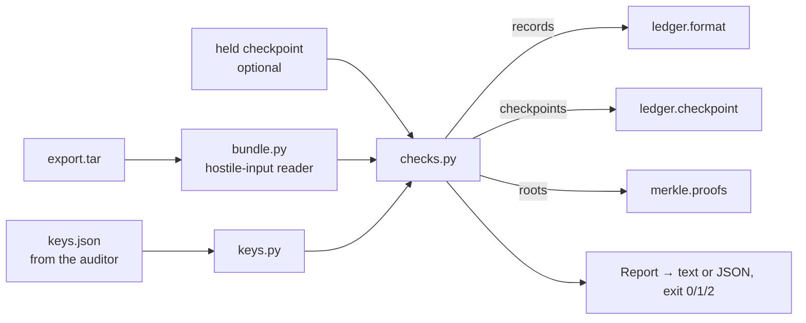

# Verify (`pl-verify`) and the export bundle

Guarantees that anyone with an export bundle and the public keys can check, offline and without trusting the operator, that every record is signed, chained, receipted and covered by signed checkpoints. When something is wrong, it names the first broken sequence number and record.

Status: done for this step (bundle v1, `pl-export`, `pl-verify`, tamper suite, differential test). Witness quorum and timestamp checks come with `witness/` and `anchor/`. · Last updated: 2026-10-27 · Tests: 78 unit + property (`verify/` 100% lines and branches, `ledger/export.py` 100%), 2 integration (`export_cli.py` 90%)

## Responsibilities

Owns:

- The export bundle v1 format: the writer is `ledger/export.py`, the reader is `verify/bundle.py`.
- `pl-export` (`ledger/export_cli.py`): writes one stream's bundle from Postgres.
- The trusted-keys file and signature checks (`verify/keys.py`).
- Every verification check (`verify/checks.py`) and the CLI (`verify/cli.py`, also `python -m verify`).

Does not own:

- Record, receipt and checkpoint formats. It reads them through `ledger.format` and `ledger.checkpoint` only.
- Merkle math (`merkle.proofs`).
- Witness cosignatures, the 2-of-3 quorum, and RFC 3161 / OpenTimestamps tokens (days 3–4).

## How it works

`pl-verify` is a second implementation of the ledger's checks. Skill §2 lets the verifier import only the pure format code, so it never reuses `ledger.chain`, `ledger.receipts` or `ledger.signing`. A property test runs both implementations on the same tampered inputs, and they must name the same first break (D32).

1. **Read the bundle as hostile input.** It must be an uncompressed tar with only the expected regular files, no links, no duplicates, and size limits on everything. Nothing is extracted to disk.
2. **Walk the records.** Each line must be canonical JSON (D20). The walk checks stream, seq, `prev_hash`, unique `record_id` and the producer signature under a trusted key owned by that producer. It stops at the first break, so one edit is not reported as a cascade. Leaf hashes are computed for every line regardless.
3. **Check receipts.** Each is verified under a trusted log key, then matched against the record at its seq: record id, leaf hash, and chain hash where the chain verified. Records without a receipt and receipts without a record are both reported.
4. **Check checkpoints.** Each note must verify under a trusted log key with the bundle's origin. Its root must equal the Merkle root of the exported records up to its size. A checkpoint larger than the export means records were removed. Two signed roots for one size means split view.
5. **Optionally, a checkpoint the auditor kept** (`--trusted-checkpoint`). If the export no longer reaches that size, it was truncated. If the root differs, history was rewritten since then. This catches an operator who rebuilt and re-signed everything with the real log key.



## Interfaces

| Function / command | Input | Output | Errors |
| --- | --- | --- | --- |
| `pl-verify BUNDLE --keys KEYS [--trusted-checkpoint NOTE] [--json]` | files | report on stdout | exit 0 verified, 1 findings, 2 cannot verify (message on stderr) |
| `pl-export --out FILE [--stream S]` | `DATABASE_URL`, `LEDGER_ORIGIN` | tar file | exit 2 on `PreceptError` |
| `await export_bundle(store, sink, stream, origin)` | `Store`, `CheckpointSink` | tar bytes | `FormatError` if a stored row is not I-JSON; `StoreError` |
| `read_bundle(data)` | bytes | `Bundle(stream, origin, records, receipts, checkpoints)` | `VerificationError bundle.not_tar`, `.bad_member`, `.duplicate`, `.too_large`, `.missing`, `.bad_manifest`, `.count_mismatch`, `.bad_lines` |
| `TrustedKeys.from_json(data)` | keys file bytes | `TrustedKeys` | `VerificationError verify.bad_keys` |
| `verify_bundle(bundle, keys, *, trusted_checkpoint=None)` | | `Report` (`ok`, `first_break`, `findings`, counts, `latest`) | `VerificationError verify.bad_trusted_checkpoint` |

Finding names, each with `seq` (or none) and `record_id` where known:

| Group | Names |
| --- | --- |
| Records (same names as `ledger.chain.BreakReason`) | `malformed`, `wrong_stream`, `seq_mismatch`, `prev_hash_mismatch`, `duplicate_record_id`, `bad_producer_signature` |
| Receipts | `malformed_receipt`, `duplicate_receipt`, `bad_receipt_signature`, `receipt_without_record`, `receipt_mismatch`, `missing_receipt` |
| Checkpoints | `bad_checkpoint`, `checkpoint_beyond_records`, `checkpoint_mismatch`, `checkpoint_conflict` |
| Held checkpoint | `truncated_since_trusted`, `rewritten_since_trusted` |

## Data

Bundle v1 (D31), one plain tar with zero timestamps and owners and a fixed member order, so the same ledger always exports the same bytes:

| Member | Content |
| --- | --- |
| `manifest.json` | `{"format": "precept-ledger-export", "v": 1, "stream", "origin", "counts": {"records", "receipts", "checkpoints"}}` |
| `records.jsonl` | Every record as stored (rebuilt from columns, D21), one canonical JSON line each, seq order |
| `receipts.jsonl` | Every receipt as stored, same encoding |
| `checkpoints/<20-digit size>.note` | Every signed checkpoint. Names are only labels; the verifier reads the size from the signed text |

The bundle carries no keys. Keys come from the auditor in a file like this:

```json
{"v": 1, "producers": {"gate-1": ["<base64 Ed25519 public key>"]}, "log": ["<base64>"]}
```

## Security and failure behaviour

| Threat or failure | Behaviour | Test |
| --- | --- | --- |
| Amount edited in the database (beat 4) | `seq 2 bad_producer_signature`, naming the record id, plus `receipt_mismatch` at seq 2 and `checkpoint_mismatch` for every checkpoint covering it | `test_edited_amount_is_named_at_its_seq`, `test_admin_edit_is_named_by_pl_verify` (Postgres) |
| Record deleted, inserted, reordered | `seq_mismatch` at the first moved position | `test_deleted_record`, `test_inserted_record`, `test_reordered_records` |
| Export truncated | `checkpoint_beyond_records` at the first missing seq | `test_truncated_export_is_caught_by_the_checkpoint` |
| Operator rebuilds history and re-signs everything with the log key | The bundle alone verifies. With a held checkpoint: `rewritten_since_trusted` | `test_rogue_operator_rewrite_is_caught_by_a_held_checkpoint` |
| Forged checkpoint, or two signed roots for one size | `bad_checkpoint` / `checkpoint_conflict` | `test_forged_checkpoint`, `test_two_signed_roots_for_one_size` |
| Unknown or misattributed producer key, wrong log key | `bad_producer_signature` / `bad_receipt_signature` | `test_unknown_producer_key`, `test_producer_key_registered_to_someone_else`, `test_receipt_signed_by_another_key` |
| Hostile tar: links, `../` paths, extra or duplicate members, compression, oversize | Refused before any check, exit 2 | `test_verify_inputs.py` |
| Network | Never used. The import test bans network modules in `verify/`; a subprocess runs `pl-verify` under an audit hook that raises on any `socket.*` event, with a positive control proving the hook works | `test_runs_with_the_network_forbidden` |
| Bad input of any kind | Exit 2, "cannot verify", never "verified" | `test_cannot_verify_exits_2` |
| Two implementations drifting apart | `ledger.chain` and `pl-verify` must agree on the first break for random edits, drops, duplicates, swaps and foreign records (400 examples) | `test_verifier_agrees_with_the_ledger_on_the_first_break` |

What it does not protect against yet:

- An operator who rewrites everything, when the auditor holds no earlier checkpoint. Witness cosignatures (day 3) and anchors (day 4) close this.
- A checkpoint mismatch is not pinned to a seq unless another check pins it. The verifier has only the current records, not the old leaves.

## Formulas and formats

Every hash and signature checked here is defined in [`ledger.md`](ledger.md), [`merkle.md`](merkle.md) and [`checkpoints.md`](checkpoints.md). This module adds no new cryptography. The verifier recomputes:

| Value | From |
| --- | --- |
| Leaf `i` | `SHA-256(0x00 ‖ line i+1)`; the line is the canonical record exactly as exported |
| Chain | `h_n = SHA-256("PL-chain-v1" ‖ h_(n−1) ‖ line n)`, `h_0` = 32 zero bytes |
| Checkpoint check | `MTH(leaf_0 … leaf_(size−1)) == root` in the signed note |

Real output, from a 5-record bundle with checkpoints at 3 and 5 (TEST ONLY keys) and the same bundle with record 2's amount changed to 480:

```text
$ pl-verify export.tar --keys keys.json
pl-verify  stream harbor-federal/decisions  (origin precept-ledger.local/harbor-federal/decisions)
records           5  chain and producer signatures verified through seq 5
receipts          5
checkpoints       2  latest: size 5, root OUhZzH8SO0TegNJa/2fPR5dbFpeWyDP8sfWzdOnqe4c=
unanchored        0  records after the latest checkpoint
RESULT  OK

$ pl-verify tampered.tar --keys keys.json
...
RESULT  FAILED: first break at seq 2 (record 01M64R6GFATP6W80RAFJC92DS0): bad_producer_signature
  seq 2     bad_producer_signature  record 01M64R6GFATP6W80RAFJC92DS0: signature does not verify
  seq 2     receipt_mismatch  record 01M64R6GFATP6W80RAFJC92DS0: leaf hash differs from the receipt
  -         checkpoint_mismatch: root of records 1..3 differs
  -         checkpoint_mismatch: root of records 1..5 differs
```

(Record ids and roots differ on each run, because ULIDs are random.)

## How to run and test

```sh
uv run pl-export --out export.tar                    # needs DATABASE_URL, KEYS_DIR, LEDGER_ORIGIN
uv run pl-verify export.tar --keys keys.json         # add --json for machine output
uv run pl-verify export.tar --keys keys.json --trusted-checkpoint held.note
uv run pytest tests/unit/test_verify*.py tests/unit/test_export.py tests/property/test_verify_properties.py
make test-integration                                # includes beat 4 end to end on Postgres
```

## Decisions

D20, D21, D28, D31, D32, D33 in [`docs/DECISIONS.md`](../DECISIONS.md).

## Known gaps

- Range exports (`?from=M&to=N`) are not built. Bundle v1 is always the whole stream from seq 1. A range export needs inclusion proofs and a consistency proof in the bundle.
- No witness keys, quorum or timestamp tokens yet. ARCHITECTURE's `--witness-keys keys/ --quorum 2` arrives with `witness/`.
- No helper writes `keys.json` from `KEYS_DIR` yet. The demo setup step will add one.
- A stored row that an admin edits into non-I-JSON (for example a float) makes `pl-export` fail with `FormatError` instead of exporting it. That fails closed, but the verifier then never sees the row.
- `pl-verify` holds the whole bundle in memory (limit 256 MiB). That's fine at demo scale.
