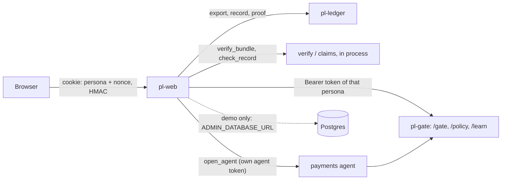

# Console (`web/`): every demo beat in one place, showing only what it verified

Guarantees that the console decides nothing and shows nothing as proven that it did not verify itself. It is a client of `pl-gate` and `pl-ledger` like any other: it acts for a person with that person's Gate token (kept on the server), and every "proven" mark comes from its own run of `pl-verify`'s checks or a record's inclusion proof.

Status: done for this step (all beats in the browser, `make web`). · Last updated: 2026-10-28 · Tests: 18 unit in `tests/unit/test_web.py`, 2 integration in `tests/integration/test_web_tamper.py`, plus 17 console import-boundary checks. Coverage: `security.py` 98%, `routes/` 89–100%, `views.py` 93%, `agent_runs.py` 92%, `backend.py` 89%, `app.py` 86%, `demo.py` 70% in unit tests (its database edit runs in the integration test).

Related pages: [`gate.md`](gate.md), [`policy.md`](policy.md), [`learn.md`](learn.md), [`agent.md`](agent.md), [`assist.md`](assist.md), [`claims.md`](claims.md), [`verify.md`](verify.md), [`../DECISIONS.md`](../DECISIONS.md) D84–D87.

## Responsibilities

Owns:

| Part | File |
| --- | --- |
| The page registry: groups, titles, demo-only pages | `web/nav.py` |
| The app factory, settings (`WEB_*`), rendering, error pages, `pl-web` | `web/app.py` |
| Sessions (persona cookie), CSRF, security headers | `web/security.py` |
| HTTP to Gate and the ledger, personas, verifying the export and single records | `web/backend.py` |
| Turning records into sentences, badges and the proof seal (pure functions) | `web/views.py` |
| Agent runs started from the browser, with live steps | `web/agent_runs.py` |
| The tamper button and the rogue-operator scenario (demo mode) | `web/demo.py` |
| One router per area | `web/routes/{overview,approvals,agent,policy,learn,ledger,audit,demo}.py` |
| Templates: base layout, component macros, pages, htmx fragments | `web/templates/` |
| Design tokens and components (one CSS file), small scripts, htmx 2.0.4 (0BSD) | `web/static/` |

Does not own: decisions (Gate), policy checks and approval (`policy/`), the learner's counts and replay (`learn/`), proofs (`claims/`, `verify/`), the agent itself (`agent/`). Each page calls those through their APIs or functions and shows the result.

## How it works



| Page | Beat | What it does | Calls |
| --- | --- | --- | --- |
| Overview | all | Proof seal, services, decision totals, latest decisions | ledger health and export, Gate health |
| Approvals | 2 | Open escalations with their brief; approve or reject; refreshes every 4 s | `/gate/v1/escalations`, `.../verdict` |
| Agent | 2 | A task in plain words; each step live (polled every second until done) | `agent.cli.open_agent` |
| Policy | 1 | Draft from a PDF (or the demo PDF, optionally with the planted fault), each rule beside its clause, findings, YAML revision, approval | `/policy/v1/*` |
| Learner | 6 | Run, proposals, SQL counts beside the model's, claims proven or rejected, replay, approvals | `/learn/v1/*` |
| Ledger | 4 | Every record newest first, filter by type, verification findings, the first broken record highlighted; one record with its own inclusion proof | export, `/records/{id}`, `/proof` |
| Audit | 3 | A question; each claim proven or rejected; earlier audits | `assist.auditor.Auditor` |
| Attacks | 4, 5 | Tamper with a payment (typed confirmation); the rogue-operator scenario | `web.demo` |

The proof seal (`views.seal`) states one of three things, from the console's own `verify_bundle` run: **proven** through the final checkpoint, with its cosigners and root; **pending** (no checkpoint yet, or the newest waits for cosignatures); **broken**, naming the first failing record and check. A record page shows its own state from `claims.checker.check_record`.

Personas: the console offers every Gate approver with a token file in `KEYS_DIR/tokens` (`make dev-keys`: j.ortiz, m.lee, a.chen, r.patel). Choosing one sets the session; the console then sends that person's token, and Gate, not the console, decides what they may do. A page warns when the chosen person lacks a role Gate will require.

Design: cool chart-paper and harbour-ink tokens, one serif for titles and record headlines, the system sans for the interface, monospace only for record ids and hashes. Colour only means an outcome (green allowed / approved / proven, amber held, red denied / broken), always with a word beside it. Light and dark themes come from the same tokens, following the system or a choice saved in the browser. The one motion that plays on its own is the seal's stamp on load; it is off under `prefers-reduced-motion`.

## Interfaces

| Function / type | Input | Output | Errors |
| --- | --- | --- | --- |
| `create_web_app(console, lifespan=None)` | a `Console` (backend, sessions, zone, demo mode, features) | FastAPI app | |
| `app_from_settings()` / `pl-web` | env (`WEB_*`, `KEYS_DIR`, `MODEL_PROFILE`, `DEMO_MODE`, `ADMIN_DATABASE_URL`) | app | `ConfigError config.keys`, `WebError config.keys` |
| `Backend(gate, ledger, stream=, trust=, personas=)` | two `httpx.AsyncClient`s | `ledger_state()`, `proven_record(id)`, `escalations`, `give_verdict`, policy and learner calls | `WebError` with Gate's or the ledger's code and status; `web.unavailable` (503) |
| `load_personas(keys_dir)` | | name → `Persona(name, kind, roles, token)`; the token is never in a repr | `WebError config.keys` |
| `Sessions(secret, personas, default)` | | `issue(name)`, `read(cookie)` → `Session(persona, csrf)` | `web.persona` |
| `views.seal(report)`, `summary(record)`, `outcome(record)`, `conditions(rule)` | | `Seal`, text | |
| `AgentRuns(factory).start(task)` | | `Run` with live `Event`s | |
| `demo.tamper(admin_url, stream, seq)`, `demo.rogue_operator()` | | rows changed; `RogueRun(exit_code, lines)` | `web.admin`, `web.timeout` |

Routes (HTML; POSTs need the session's CSRF token; each answers htmx with a fragment and a plain form with a 303):

| Method | Path |
| --- | --- |
| GET | `/`, `/approvals`, `/approvals/queue`, `/agent`, `/agent/runs/{id}`, `/policy`, `/policy/drafts/{id}`, `/learn`, `/learn/proposals/{id}`, `/ledger?kind=&page=`, `/ledger/records/{id}`, `/audit`, `/demo` |
| POST | `/session/persona`, `/approvals/{id}/verdict`, `/agent/runs`, `/policy/drafts`, `/policy/drafts/{id}/revisions`, `/policy/drafts/{id}/approve`, `/learn/run`, `/learn/proposals/{id}/approve`, `/audit/ask`, `/demo/tamper`, `/demo/rogue` |

Adding a page: one router module in `web/routes/`, one `Page` in `web/nav.py`, one template that extends `base.html` and builds from `macros.html`.

## Data

The console stores nothing durable. Agent runs live in memory (the last 20). Sessions are cookies. Every fact on a page is read from Gate or the ledger at request time; the theme choice is the browser's own `localStorage`.

## Security and failure behaviour

| Threat or failure | Result | Test |
| --- | --- | --- |
| A forged or edited session cookie | HMAC-SHA256 with a per-process key (or `WEB_SESSION_SECRET`); a renamed persona or a foreign key is rejected and the default persona issued | `test_sessions_are_signed_and_bound_to_a_known_persona` |
| Cross-site request forgery | Every POST needs the session's token (HMAC of its nonce), as a form field or `X-CSRF-Token`; the cookie is `HttpOnly` and `SameSite=Strict` | `test_every_page_is_safe_by_default` |
| Script injection | Jinja autoescaping; CSP `default-src 'self'`, no inline script or style, `frame-ancestors 'none'`, `object-src 'none'`; htmx with `allowEval` and `allowScriptTags` off and `selfRequestsOnly` | same |
| A Gate token reaching the browser | Tokens stay in `Backend`; pages never render them; `Persona`'s repr omits the token | same, `test_sessions_...` |
| Acting beyond a person's role | Gate decides with that person's token; the console shows Gate's refusal (`gate.approver_not_allowed`, `policy.forbidden`, `learn.forbidden`) | `test_a_supervisor_approves_a_held_payment`, `test_beat_1_in_the_console` |
| Showing an unverified log as proven | The seal comes from `verify_bundle` with the witness quorum; a record is "proven" only when `check_record` passes | `test_the_overview_and_ledger_show_the_proof`, `test_the_seal_says_...` |
| Gate or the ledger down | The overview says which is unreachable; other pages explain and return 503 | `test_the_console_says_when_gate_is_down` |
| The tamper button outside a demo | The Attacks page and its actions return 404 unless `DEMO_MODE=true`; the edit also needs `ADMIN_DATABASE_URL` and a typed "tamper" | `test_the_attacks_page_needs_demo_mode_...` |
| The tamper edit | Real: one `gate.decision`'s amount times ten, triggers off for that session only; `pl-verify` then names that record | `test_the_tamper_button_edits_one_amount_and_verification_names_it` (integration) |
| The rogue scenario touching live data | Runs in a separate process with throwaway keys in a temporary directory | `test_the_real_rogue_operator_scenario_is_caught` |
| A bug in a page | Logged with its type only; the user sees a plain error page (`web.internal`), never a stack trace | `_web_error` |
| A database or store reached from pages | Import test: no ledger store, service or Gate core anywhere in `web/`; `psycopg` only in `web/demo.py` | `test_the_console_has_no_write_path_but_the_demo_button` |

What it does not protect against:

- **Who is at the keyboard.** The persona menu is a demo stand-in for sign-in: anyone who can reach the console can act as any listed person. It binds to 127.0.0.1 by default for this reason. Production needs real sign-in (SSO) mapped to Gate tokens.
- **The console's own `assist-1` key.** Like `make demo-audit`, the console signs `assist.qa` records when `KEYS_DIR/assist-1.pem` exists; whoever runs it can write audit records (never Gate or log records).

## How to run and test

```bash
make serve           # with WITNESSES=..., so checkpoints become final
make gate DEMO_MODE=true
DEMO_MODE=true make web    # http://127.0.0.1:8090; DEMO_MODE adds the Attacks page
uv run pytest tests/unit/test_web.py
make test-integration      # includes the real tamper edit
```

Settings (`WEB_*`, see `.env.example`): `HOST`, `PORT` (8090), `GATE_URL`, `LEDGER_URL`, `DEFAULT_PERSONA` (j.ortiz), `TIMEZONE`, `TIMEOUT_SECONDS` (120: a learner run or audit waits for the model), `WITNESSED` (true), `SECURE_COOKIE`, `SESSION_SECRET`. `ADMIN_DATABASE_URL` enables the tamper button with `DEMO_MODE=true`.

Run against the dev stack on 2026-10-28 (mock profile): the overview showed "Proven through record 314, cosigned by witness-1, witness-2, witness-3"; an agent task started from the browser ("Pay Keystone IT $120.00 for invoice INV-2.") ran lookup, payment and the accounts-payable email through the live `pl-gate`, each step showing Gate's decision record.

## Decisions

D84 (server-rendered with htmx, vendored), D85 (personas instead of sign-in, demo only), D86 (the console verifies what it shows), D87 (tamper is a real admin edit; the rogue scenario runs in a sandbox).

## Known gaps

- Real sign-in (SSO) instead of the persona menu.
- The Audit page and agent runs use the model profile; on `cloud`, a learner run or audit takes as long as the model (up to `WEB_TIMEOUT_SECONDS`).
- The ledger page verifies the whole export on each load; fine for the demo's hundreds of records, too slow for millions (a range export is a known gap in the ledger API).
- Agent runs are kept in memory and lost on restart; their effects are in the ledger.
